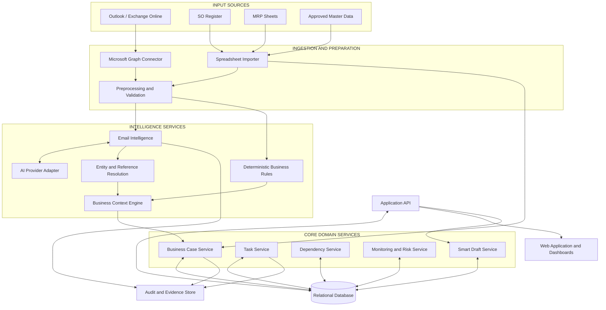
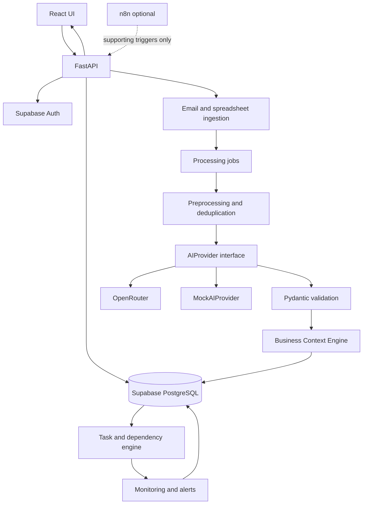

# Balbird Intelligence

## Master Product Requirements, System Architecture, Data Model, Workflows, Security and AI-Agent Implementation Specification

**Document type:** Canonical implementation specification\
**Product:** Balbird Intelligence\
**Version:** 2.0 — POC implementation edition\
**Status:** Development baseline --- validate tenant-specific details
before production\
**Primary deployment target:** Customer-controlled Microsoft 365 / Azure
environment\
**Initial development mode:** Local development with fabricated data; OpenRouter free-model experiments are synthetic-data-only\
**Primary pilot:** One explicitly approved mailbox, beginning in
read-only mode

------------------------------------------------------------------------

## How an AI coding agent must use this document

This document is the canonical product and engineering brief for
implementing Balbird Intelligence. Read it completely before changing
code or designing the database.

### Implementation rules

1.  Treat requirements marked **MUST** as mandatory.
2.  Treat requirements marked **SHOULD** as strong recommendations. If
    not implemented, document the reason.
3.  Treat requirements marked **MAY** as optional.
4.  Do not invent business rules, employee identities, tenant IDs,
    mailbox permissions, SO fields, MRP formulas, or company-specific
    workflows. Make these configurable and record unresolved
    assumptions.
5.  Do not replace an existing repository, workflow, database, n8n
    automation, Supabase structure, or user-provided artifact without
    first inspecting it and documenting the proposed change. If this
    project is being added to an existing Balbird/Task Orch codebase,
    preserve working functionality and provide a migration plan.
6.  Build a functioning vertical slice before expanding breadth: **email
    → intelligence → Business Case → task → dependency → dashboard**.
7.  Use fabricated data for development and demonstrations. Never use
    real STAUFF data, mailboxes, credentials, or attachments without
    explicit authorisation.
8.  AI output is a proposal, not an authoritative business record.
    Preserve source evidence, confidence, validation state, and human
    corrections.
9.  All consequential write operations must be permission-gated,
    auditable, and disabled by default until explicitly approved.
10. Keep business logic modular and provider-independent. Do not make
    the entire application one large prompt, one automation workflow, or
    one tightly coupled service.
11. Before each implementation phase, inspect the repository, report
    what already exists, and make the smallest safe set of changes.
12. If a requirement cannot be implemented because a business rule,
    source field, API permission, or external system is unknown, create
    a clearly labelled configuration/TODO item. Do not silently guess.

### Requirement language

-   **MUST:** required for correctness, security, or acceptance.
-   **SHOULD:** expected unless a documented reason prevents it.
-   **MAY:** optional or future capability.
-   **TBD:** requires confirmation from the product owner, customer IT,
    or source-system owner.

------------------------------------------------------------------------

# 1. Product definition

## 1.1 What Balbird is

Balbird Intelligence is an email-centric business intelligence,
task-coordination, and workflow-monitoring system.

It connects business communication from Microsoft Outlook with
operational reference information from Sales Order (SO) registers,
Material Requirements Planning (MRP) sheets, and approved master data.

It interprets communication, identifies business context, extracts
actions and commitments, connects related messages and operational
records, maps tasks and dependencies, monitors progress, and presents
relevant information to employees, team leaders, departments, and
management.

Balbird is an **intelligence and coordination layer** over existing
systems. It is not intended to replace Outlook, ERP, MRP, or
departmental operating processes.

## 1.2 The problem being solved

Business work is distributed across:

-   Email messages, replies, forwards, and long conversation threads.
-   Customer and supplier correspondence.
-   Sales enquiries, RFQs, quotations, POs, and SOs.
-   Purchase and supplier confirmations.
-   PPC and production updates.
-   Quality and inspection updates.
-   Dispatch and logistics communication.
-   Central SO and MRP spreadsheets.
-   Employees and departments with interdependent responsibilities.

As a result:

-   Important requests can be missed.
-   Ownership can be unclear.
-   Commitments and deadlines can be buried in email threads.
-   The same activity can be discussed in multiple conversations.
-   One order's delay can affect several other orders.
-   Management lacks a consolidated view of actual work and blockers.
-   Employees spend time writing repetitive follow-up emails and
    manually checking status.

Balbird should make this work visible, connected, traceable, and easier
to coordinate.

## 1.3 Product objective

The central product cycle is:

**Outlook emails + SO/MRP data → preprocessing → AI intelligence →
business context → tasks → dependencies → monitoring → employee action →
feedback and improvement.**

The core value is not email categorisation by itself. Email
categorisation is the entry point. The value is connecting communication
to business cases, operational records, work, responsibility,
dependencies, and outcomes.

## 1.4 Product principles

1.  **Email is the primary communication backbone.**
2.  **SO and MRP records are operational reference sources.**
3.  **Business Cases connect information from different sources.**
4.  **Tasks represent actual work that must be performed.**
5.  **Dependencies explain sequencing, blockers, and downstream
    impact.**
6.  **Smart Drafts assist employees; they do not make unapproved
    commitments.**
7.  **Dashboards provide role-appropriate visibility.**
8.  **Source evidence and validation protect accuracy.**
9.  **Humans remain accountable for consequential business decisions.**
10. **The customer controls its data, infrastructure, and access.**
11. **The first development environment uses fabricated data.**
12. **The system must be modular, testable, observable, and
    maintainable.**

------------------------------------------------------------------------

# 2. Scope and boundaries

## 2.1 Version 1 scope

Version 1 MUST provide:

-   A local fabricated-data development environment.
-   Employee, department, customer, supplier, and part reference
    structures.
-   Outlook email ingestion through a connector abstraction, with
    Microsoft Graph as the intended production connector.
-   Email preprocessing and conversation/thread association.
-   Email classification and intent detection.
-   Extraction of entities, actions, priorities, deadlines, commitments,
    and follow-ups.
-   Business Case creation and matching.
-   SO and MRP spreadsheet import and validation.
-   Task creation, updates, ownership, status, and due dates.
-   Dependency relationships and blocker tracking.
-   Monitoring for overdue, blocked, waiting, and at-risk activities.
-   Basic Smart Draft generation with human review.
-   Employee, team leader, department, and management dashboard views.
-   Source traceability, audit history, and human correction capture.
-   Test fixtures, expected results, evaluation metrics, and regression
    tests.
-   Documentation for installation, configuration, operation, security,
    and deployment.

## 2.2 Explicit exclusions from Version 1

Do NOT build these unless separately authorised:

-   A replacement for Outlook.
-   A replacement for ERP or MRP.
-   A full document-management system.
-   Deep technical drawing interpretation.
-   Detailed QC report calculations.
-   Full production planning or scheduling software.
-   Automatic creation or modification of ERP sales orders.
-   Automatic purchase order creation.
-   Automatic modification of MRP source spreadsheets.
-   Automatic email sending.
-   Unsupervised business decision-making.
-   Enterprise-wide mailbox access before customer security approval.
-   Bulk ingestion of 28 years of historical records as an initial
    milestone.
-   An autonomous agent that silently changes business rules or
    operational data.

## 2.3 Selective document handling

Email remains the primary source of communication. SO/MRP remains the
operational reference.

Balbird MAY retain approved attachment references and extract limited
metadata where necessary. It SHOULD initially identify the attachment,
its source email, filename, type, timestamp, and access reference rather
than attempting universal document understanding.

Selective extraction may be added for a clearly defined verification use
case. Deep drawing interpretation, full technical-document analysis, and
detailed quality calculations are outside Version 1.

------------------------------------------------------------------------

# 3. Users, roles, and permissions

The system must support role-based access control (RBAC). Actual roles
and permissions must be configurable to match customer policy.

## 3.1 Initial role model

  -----------------------------------------------------------------------
  Role                                Typical access
  ----------------------------------- -----------------------------------
  Employee                            Own tasks, assigned cases,
                                      permitted team-task context,
                                      approved email/task evidence

  Team Leader                         Team workload, team tasks, team
                                      cases, blockers, relevant updates

  Department Head                     Department workload,
                                      department-level cases and
                                      performance

  Management                          Cross-department summaries and
                                      authorised business risks

  System Administrator                Application configuration,
                                      user/role administration,
                                      operational health

  Auditor / Security Reviewer         Approved audit and security
                                      records, without unnecessary
                                      message-body access

  Integration Service                 Minimum technical permissions
                                      required for approved ingestion or
                                      write-back
  -----------------------------------------------------------------------

These are proposed role categories, not assumptions about actual STAUFF
permission policy.

## 3.2 Permission requirements

-   Enforce permissions in the backend, not only in the UI.
-   Deny access by default.
-   Scope email content and attachments to the permissions granted by
    the source system and customer policy.
-   A user seeing a team task does not automatically gain permission to
    read its source email or attachment.
-   Management summaries must not expose restricted message content.
-   Administrative access must not automatically imply permission to
    read all business emails.
-   Record permission changes and privileged actions.
-   Support disabling a user and revoking active access.
-   Keep service identities separate from human identities.
-   Never use a shared personal account as a production integration
    identity.

## 3.3 Task visibility and team context

When an employee participates in a team task, the employee SHOULD be
able to see the other tasks and progress that belong to that same
authorised parent/team activity, so they can understand overall progress
and dependencies.

This does not grant unrestricted visibility into all tasks in the
organisation.

Employee identifiers should be assigned by the identity/master-data
process. Do not ask end users to invent employee numbers. If a
sequential employee number is required for a fabricated demo, generate
it deterministically from the seeded employee dataset. In production,
use the approved identity source or stable internal ID.

------------------------------------------------------------------------

# 4. High-level system architecture

## 4.1 Two independent input pipelines

The architecture has two primary input pipelines that converge at the
Business Context Engine.

### Pipeline A --- Outlook

Microsoft 365 / Exchange Online\
→ Microsoft Graph connector\
→ authorised mailbox event or controlled synchronisation\
→ backend ingestion service\
→ raw metadata and permitted content staging\
→ preprocessing\
→ email intelligence\
→ context matching\
→ business-case and task updates.

### Pipeline B --- SO/MRP and reference data

Approved SO register / MRP spreadsheets / master data\
→ import service\
→ schema mapping\
→ validation and normalisation\
→ versioned structured records\
→ operational context and reconciliation\
→ business-case and task updates.

### Convergence

Both pipelines connect through a shared domain model:

-   Business Case.
-   Customer.
-   Supplier.
-   Part.
-   RFQ.
-   Quotation.
-   Customer PO.
-   Sales Order.
-   Email and conversation.
-   Task.
-   Dependency.
-   Commitment.
-   Event and evidence.

## 4.2 Logical architecture diagram



## 4.3 Architectural requirements

-   Use a central relational database for structured relationships and
    transactional state.
-   Keep source messages, source references, extracted facts, and
    business entities distinct.
-   Use service/API boundaries between modules.
-   Keep the AI provider behind an adapter interface.
-   Keep Microsoft Graph behind a connector interface.
-   Keep spreadsheet schemas configurable.
-   Use background jobs for ingestion, AI processing, imports,
    reconciliation, and monitoring.
-   Make processing idempotent: retrying an event must not create
    duplicate emails, tasks, or business cases.
-   Use a transactional outbox or equivalent reliable event-delivery
    pattern where appropriate.
-   Maintain correlation IDs across a processing run.
-   Support retry, dead-letter handling, and replay of failed jobs.
-   Do not rely on an LLM for exact arithmetic, authoritative identifier
    validation, permissions, or database integrity.

------------------------------------------------------------------------

# 5. Recommended technology design

The following is a recommended baseline, not a requirement to ignore an
existing working repository or customer technology standards.

## 5.1 Development stack

  -----------------------------------------------------------------------
  Layer                   Recommended option      Purpose
  ----------------------- ----------------------- -----------------------
  Backend                 Python + FastAPI        APIs and business logic

  Database                PostgreSQL              Relational business
                                                  data

  Local lightweight mode  SQLite                  Small local demos and
                                                  unit tests only

  Frontend                React + TypeScript      Web dashboards and
                                                  workflows

  AI                      OpenRouter API            OpenAI-compatible
                                                  inference gateway;
                                                  free model variants
                                                  for synthetic-data POC

  AI provider fallback     Mock provider             Deterministic tests,
                                                  offline development,
                                                  and quota-safe operation

  Email connector          Synthetic JSON/.eml       POC input; Microsoft
                           fixtures first            Graph added only after
                                                  tenant approval

  Background processing   Python worker              Async ingestion,
                                                  analysis, imports,
                                                  reconciliation

  Workflow orchestration  n8n Community              Optional supporting
                           self-hosted                orchestration only;
                                                  not the source of truth

  Spreadsheet processing  pandas / openpyxl          Excel import and
                                                  validation

  Testing                 pytest + Bruno              Unit, integration,
                                                  API and workflow tests

  Version control         Git + GitHub                Source control

  Deployment              Local Docker Compose        POC; customer-approved
                                                  hosting later

The team may choose equivalent technologies if the repository or
customer environment requires them. Document the decision and
trade-offs.

## 5.2 Provider adapters

The POC MUST implement `OpenRouterAIProvider` and `MockAIProvider`.
OpenRouter is the selected experimental inference service; it is not
approved for confidential customer data merely because a model is marked
free. The POC MUST use synthetic or explicitly approved data only.


Create interfaces such as:

-   `EmailProvider`: fetch messages, read permitted metadata/body, fetch
    attachment metadata/content if authorised, subscribe to events,
    apply approved categories/flags.
-   `AIProvider`: structured extraction, classification, summarisation,
    draft generation.
-   `StorageProvider`: approved attachment or evidence storage.
-   `IdentityProvider`: user identity and group/role resolution.
-   `NotificationProvider`: approved in-app or email notifications.

The domain layer must not depend directly on a specific model vendor or
Graph SDK.

## 5.3 Configuration and secrets

-   Use environment variables or a secrets manager.
-   Provide `.env.example` containing placeholders only.
-   Never commit client secrets, access tokens, private keys, passwords,
    real mailbox content, or production connection strings.
-   Validate required configuration at startup.
-   Separate development, test, staging, and production settings.
-   Never silently fall back from a secure production provider to an
    unapproved external provider.
-   Never silently switch from a free OpenRouter model to a paid model.
-   Enforce request/day and request/minute budgets in application code;
    treat provider-side quotas as an additional limit, not the only
    protection.
-   Make model IDs, request limits, timeouts, retry policy and maximum
    token budgets configurable.
-   Record provider, model ID, prompt version, schema version, latency,
    token usage when returned, outcome and error class. Do not log raw
    email bodies or secrets.
-   A quota/rate-limit response must place work in a retryable
    `waiting_for_provider_quota` state. It must not mark the email as
    successfully analysed.
-   Provide a mock/deterministic provider so core workflows and tests
    remain usable when OpenRouter is unavailable.

------------------------------------------------------------------------

# 6. Core domain model and terminology

Use consistent names across code, API, database, tests, and UI.

## 6.1 Business Case

A Business Case is the central operational context that groups related
business activity.

Example: `CASE-2026-00125`.

A Business Case may connect:

-   One or more customers or relevant business parties.
-   One or more suppliers.
-   One or more RFQs.
-   One or more quotations.
-   One or more customer POs.
-   One or more SOs.
-   Multiple line items and parts.
-   Multiple email conversations and messages.
-   Tasks and dependencies.
-   Commitments, decisions, risks, and evidence.

Do not assume one email equals one case or one case equals one SO.

Support: - One email referring to multiple cases. - One supplier
communication affecting multiple SOs. - Multiple email conversations
belonging to one case. - One RFQ containing 1,000 or more line items. -
One case with multiple parts and quantities. - Cases with no confirmed
SO yet. - Cases with uncertain matching requiring human review.

## 6.2 Source message

A Source Message is an imported representation of an Outlook message,
preserving source identifiers and permitted content.

A message must be traceable to its source mailbox and provider ID.

## 6.3 Conversation

A Conversation groups messages using provider conversation/thread
identifiers and additional safe linkage rules. Subject similarity alone
must not be treated as definitive proof of a shared conversation.

## 6.4 Extracted fact

An Extracted Fact is a machine- or human-derived assertion from a
source, such as:

-   Supplier promised delivery on a date.
-   Customer requested a quantity.
-   PPC must confirm a schedule.
-   Material is reported received.
-   QC is pending.

Every fact must have provenance, extraction method,
confidence/validation state, and lifecycle status.

## 6.5 Task

A Task is an actionable unit of work with a description, owner or
unresolved owner, status, source evidence, due date or unresolved due
date, and optional dependencies.

## 6.6 Dependency

A Dependency expresses a relationship between tasks, milestones, or
business objects. Example: production scheduling depends on material
availability.

## 6.7 Commitment

A Commitment records a promise or expectation made by a customer,
supplier, employee, or other party. It is not automatically equivalent
to a verified outcome.

## 6.8 Evidence

Evidence is a source reference or approved content excerpt supporting a
classification, fact, task, status, or decision.

## 6.9 Distinguish reported, confirmed, and verified

Never collapse these states:

-   **Reported:** someone stated that an event occurred.
-   **Confirmed:** an appropriate party or source explicitly confirmed
    it.
-   **Verified:** the system or an authorised user checked suitable
    evidence.
-   **Completed:** the operational task is marked complete under the
    applicable workflow.

For example, an email saying "material received" is a report. A matching
GRN or authorised confirmation may provide verification, depending on
the configured business rule.

------------------------------------------------------------------------

# 7. Data model

The following is a logical schema. Implement it with appropriate
database types, constraints, indexes, migrations, and tenant/customer
scoping where required.

Do not force optional or unknown values into fabricated defaults.

## 7.1 Core tables

### `users`

-   `id` --- stable internal UUID.
-   `external_identity_id` --- approved identity-provider identifier.
-   `display_name`.
-   `email_address`.
-   `department_id`.
-   `manager_user_id` --- nullable.
-   `is_active`.
-   `created_at`.
-   `updated_at`.

### `departments`

-   `id`.
-   `code`.
-   `name`.
-   `parent_department_id` --- nullable.
-   `is_active`.

### `customers`

-   `id`.
-   `customer_code` --- nullable where unavailable.
-   `name`.
-   `aliases` --- structured list or alias table.
-   `status`.
-   `source_reference`.
-   `created_at`.
-   `updated_at`.

### `suppliers`

-   `id`.
-   `supplier_code` --- nullable.
-   `name`.
-   `aliases`.
-   `status`.
-   `source_reference`.
-   `created_at`.
-   `updated_at`.

### `parts`

-   `id`.
-   `part_number`.
-   `description`.
-   `material_code` --- nullable unless a confirmed business rule
    supplies a default.
-   `unit_of_measure`.
-   `aliases`.
-   `is_active`.
-   `source_reference`.
-   `created_at`.
-   `updated_at`.

Do not apply the historical catalogue rule "default material code = PP"
globally unless the product owner confirms that it applies to this
dataset and use case. If applicable, make it an explicit, tested
configuration rule with provenance.

### `business_cases`

-   `id` --- UUID.
-   `case_number` --- unique human-readable ID.
-   `title`.
-   `case_type` --- configurable: enquiry, RFQ, order, project, issue,
    etc.
-   `status`.
-   `primary_customer_id` --- nullable.
-   `primary_owner_user_id` --- nullable.
-   `priority`.
-   `opened_at`.
-   `closed_at` --- nullable.
-   `summary` --- optional generated summary, clearly labelled.
-   `created_at`.
-   `updated_at`.
-   `created_by`.

### `business_case_parties`

-   `id`.
-   `business_case_id`.
-   `party_type` --- customer, supplier, internal, other.
-   `party_id`.
-   `relationship_role` --- buyer, seller, manufacturer, logistics
    provider, etc.

### `business_case_links`

-   `id`.
-   `business_case_id`.
-   `linked_object_type`.
-   `linked_object_id`.
-   `relationship_type`.
-   `match_method`.
-   `match_confidence`.
-   `validation_status`.
-   `created_at`.
-   `created_by`.

Use explicit foreign keys or typed association tables where feasible.
Avoid unconstrained polymorphic references if they weaken integrity.

### `source_mailboxes`

-   `id`.
-   `provider`.
-   `tenant_reference` --- non-secret identifier.
-   `mailbox_reference` --- protected or appropriately scoped.
-   `display_name`.
-   `sync_mode`.
-   `permission_profile`.
-   `is_enabled`.
-   `last_sync_at`.

### `source_messages`

-   `id`.
-   `source_mailbox_id`.
-   `provider_message_id`.
-   `provider_conversation_id` --- nullable.
-   `internet_message_id` --- nullable.
-   `subject`.
-   `sender_address`.
-   `sender_display_name`.
-   `to_recipients` --- structured data.
-   `cc_recipients` --- structured data.
-   `sent_at`.
-   `received_at`.
-   `body_text` --- nullable and subject to approved retention policy.
-   `body_html` --- avoid storing unless explicitly necessary and
    approved.
-   `body_hash`.
-   `has_attachments`.
-   `is_read_only_source`.
-   `processing_status`.
-   `source_web_link` --- only if permitted and useful.
-   `created_at`.
-   `updated_at`.

Unique constraint: `(source_mailbox_id, provider_message_id)`.

### `source_attachments`

-   `id`.
-   `source_message_id`.
-   `provider_attachment_id`.
-   `filename`.
-   `content_type`.
-   `size_bytes`.
-   `content_hash` --- nullable.
-   `storage_reference` --- nullable and protected.
-   `processing_status`.
-   `retention_status`.
-   `created_at`.

Do not download or persist attachment bytes unless the permission,
business need, and retention policy allow it.

### `email_analyses`

-   `id`.
-   `source_message_id`.
-   `analysis_version`.
-   `model_provider`.
-   `model_name` --- if permitted.
-   `prompt_version`.
-   `domain`.
-   `intent`.
-   `summary`.
-   `priority`.
-   `follow_up_required`.
-   `confidence`.
-   `validation_status`.
-   `processed_at`.
-   `raw_structured_output` --- sanitised and retention-controlled.

### `extracted_facts`

-   `id`.
-   `source_message_id`.
-   `business_case_id` --- nullable until matched.
-   `fact_type`.
-   `subject_entity_type`.
-   `subject_entity_id` --- nullable.
-   `predicate`.
-   `value`.
-   `normalised_value`.
-   `unit`.
-   `asserted_by_party_type`.
-   `asserted_by_party_id`.
-   `effective_at` --- nullable.
-   `confidence`.
-   `validation_status`.
-   `evidence_reference`.
-   `created_at`.
-   `supersedes_fact_id` --- nullable.

Facts should be append-oriented. Corrections should preserve the
original assertion and record a correction or superseding fact.

### `sales_orders`

-   `id`.
-   `so_number`.
-   `customer_id`.
-   `order_date`.
-   `requested_delivery_date`.
-   `status`.
-   `source_import_id`.
-   `source_row_reference`.
-   `last_source_updated_at`.
-   `created_at`.
-   `updated_at`.

### `sales_order_lines`

-   `id`.
-   `sales_order_id`.
-   `line_number`.
-   `part_id` --- nullable if unresolved.
-   `source_part_number`.
-   `description`.
-   `ordered_quantity`.
-   `delivered_quantity`.
-   `balance_quantity`.
-   `unit_of_measure`.
-   `delivery_date`.
-   `status`.
-   `source_row_reference`.

### `rfqs`

-   `id`.
-   `rfq_number`.
-   `customer_id`.
-   `received_at`.
-   `status`.
-   `source_reference`.

### `rfq_lines`

-   `id`.
-   `rfq_id`.
-   `line_number`.
-   `source_part_number`.
-   `part_id` --- nullable.
-   `description`.
-   `quantity`.
-   `unit_of_measure`.
-   `required_date`.
-   `technical_status`.

Support 1,000+ lines per RFQ without loading all lines into one UI
payload.

### `purchase_orders`

-   `id`.
-   `po_number`.
-   `supplier_id`.
-   `status`.
-   `order_date`.
-   `expected_delivery_date`.
-   `source_import_id`.

### `purchase_order_lines`

-   `id`.
-   `purchase_order_id`.
-   `line_number`.
-   `part_id` --- nullable.
-   `source_part_number`.
-   `ordered_quantity`.
-   `received_quantity`.
-   `expected_delivery_date`.
-   `status`.

### `mrp_snapshots`

-   `id`.
-   `source_import_id`.
-   `snapshot_at`.
-   `source_file_name`.
-   `schema_version`.
-   `import_status`.

### `mrp_records`

-   `id`.
-   `mrp_snapshot_id`.
-   `part_id` --- nullable.
-   `source_part_number`.
-   `available_stock`.
-   `reserved_stock`.
-   `required_quantity`.
-   `pending_purchase_quantity`.
-   `open_po_quantity`.
-   `open_so_quantity`.
-   `open_work_order_quantity`.
-   `shortage_quantity` --- computed or source-derived, clearly
    identified.
-   `unit_of_measure`.
-   `planning_date`.
-   `source_row_reference`.

Store source values and derived values distinctly. Do not assume all
source spreadsheets use identical formulas.

### `tasks`

-   `id`.
-   `task_number`.
-   `business_case_id` --- nullable only when genuinely unlinked.
-   `parent_task_id` --- nullable.
-   `title`.
-   `description`.
-   `task_type`.
-   `department_id` --- nullable.
-   `owner_user_id` --- nullable.
-   `suggested_owner_user_id` --- nullable.
-   `created_by`.
-   `priority`.
-   `status`.
-   `due_at` --- nullable.
-   `due_date_confidence` --- nullable.
-   `completion_reported_at` --- nullable.
-   `completed_at` --- nullable.
-   `verification_status`.
-   `created_at`.
-   `updated_at`.
-   `version`.

### `task_sources`

-   `id`.
-   `task_id`.
-   `source_message_id`.
-   `extracted_fact_id` --- nullable.
-   `relationship_type`.
-   `created_at`.

This allows a task to be supported by multiple emails or facts.

### `task_assignments`

-   `id`.
-   `task_id`.
-   `user_id`.
-   `assignment_role`.
-   `assigned_by`.
-   `assigned_at`.
-   `ended_at` --- nullable.

Preserve assignment history rather than overwriting the only owner
field.

### `task_updates`

-   `id`.
-   `task_id`.
-   `updated_by`.
-   `previous_status`.
-   `new_status`.
-   `update_text`.
-   `reason_for_delay` --- nullable.
-   `evidence_reference` --- nullable.
-   `created_at`.

### `dependencies`

-   `id`.
-   `predecessor_type`.
-   `predecessor_id`.
-   `successor_type`.
-   `successor_id`.
-   `dependency_type`.
-   `status`.
-   `reason`.
-   `source_message_id` --- nullable.
-   `confidence`.
-   `validation_status`.
-   `created_at`.
-   `created_by`.

Use typed references or separate task-dependency and
business-object-dependency tables if necessary for referential
integrity.

### `commitments`

-   `id`.
-   `business_case_id`.
-   `source_message_id`.
-   `party_type`.
-   `party_id` --- nullable.
-   `commitment_type`.
-   `description`.
-   `committed_date` --- nullable.
-   `committed_quantity` --- nullable.
-   `unit_of_measure` --- nullable.
-   `status`.
-   `confidence`.
-   `validation_status`.
-   `created_at`.

### `smart_drafts`

-   `id`.
-   `business_case_id` --- nullable.
-   `source_message_id` --- nullable.
-   `created_by`.
-   `template_key`.
-   `recipient_suggestions`.
-   `subject`.
-   `body`.
-   `missing_fields`.
-   `approval_status`.
-   `created_at`.
-   `updated_at`.

### `imports`

-   `id`.
-   `source_type`.
-   `source_file_name`.
-   `source_hash`.
-   `schema_mapping_version`.
-   `started_at`.
-   `completed_at`.
-   `status`.
-   `rows_read`.
-   `rows_created`.
-   `rows_updated`.
-   `rows_rejected`.
-   `error_summary`.

### `audit_events`

-   `id`.
-   `actor_type`.
-   `actor_id`.
-   `action`.
-   `entity_type`.
-   `entity_id`.
-   `before_state_reference` --- protected or redacted.
-   `after_state_reference` --- protected or redacted.
-   `correlation_id`.
-   `reason`.
-   `created_at`.

Never put secrets, access tokens, full email bodies, or unnecessary
sensitive content in audit logs.

### `human_feedback`

-   `id`.
-   `user_id`.
-   `entity_type`.
-   `entity_id`.
-   `feedback_type`.
-   `original_value`.
-   `corrected_value`.
-   `reason`.
-   `source_message_id` --- nullable.
-   `created_at`.
-   `review_status`.

## 7.2 Data integrity requirements

-   Use UUIDs or equivalent stable internal primary keys.
-   Use unique constraints on provider IDs and stable source
    identifiers.
-   Preserve original source values alongside normalised values.
-   Preserve import version and row provenance.
-   Use decimal types for quantities, not binary floating-point.
-   Store timestamps in UTC and display them in the user's configured
    timezone.
-   Store date-only business deadlines separately from timestamps when
    time-of-day is not specified.
-   Do not invent a time for a date-only deadline.
-   Record units of measure and avoid comparing incompatible units.
-   Use soft deletion or explicit archival where required for
    auditability.
-   Apply tenant/customer scoping where the application supports
    multiple customer environments.
-   Add indexes for SO number, PO number, RFQ number, part number,
    customer, supplier, case number, message ID, conversation ID, task
    status, owner, due date, and relevant foreign keys.
-   Add pagination and query limits to all potentially large
    collections.

------------------------------------------------------------------------

# 8. Outlook / Microsoft Graph integration

## 8.1 Purpose

Outlook is the primary communication input.

Use Microsoft Graph for approved access to Exchange Online. The exact
permission model must be reviewed with customer IT.

## 8.2 Connector capabilities

The connector should support:

-   Initial controlled synchronisation.
-   Incremental message synchronisation.
-   Message metadata retrieval.
-   Permitted body retrieval.
-   Conversation identifiers.
-   Attachment metadata retrieval.
-   Change notifications or delta queries where supported and approved.
-   Retry and throttling handling.
-   Token refresh using approved identity mechanisms.
-   Checkpointing and replay.
-   Approved category/flag write-back in a later phase.

## 8.3 Ingestion flow

1.  A new message arrives or a synchronisation job identifies a change.
2.  The connector validates that the mailbox is authorised.
3.  The message is fetched using the least required permission.
4.  The system records source mailbox, provider message ID, conversation
    ID, sender, recipients, subject, timestamps, and permitted body
    content.
5.  A stable hash is calculated for duplicate/change detection.
6.  The message is stored or staged according to retention policy.
7.  A processing job is queued.
8.  Preprocessing and intelligence run asynchronously.
9.  The result is validated and linked to a business case or review
    queue.
10. The dashboard is updated.
11. In read-only mode, no Outlook modifications occur.

## 8.4 Email preprocessing

The preprocessor should:

-   Normalise line endings and encoding.
-   Extract readable plain text from approved message content.
-   Remove or mark quoted history without destroying access to the
    original message.
-   Identify signatures and disclaimers where feasible.
-   Preserve message boundaries and timestamps.
-   Avoid treating quoted historical requests as new requests.
-   Preserve sender, recipient, CC, and date context.
-   Detect likely automated notifications and newsletters.
-   Detect empty, malformed, or unsupported messages.
-   Handle long threads with controlled chunking and thread-level
    context.
-   Preserve source references for every extracted statement.

Do not delete original source evidence merely because the AI sees a
cleaned representation.

## 8.5 Conversation and thread handling

-   Use provider conversation IDs as a strong signal.
-   Use internet message IDs and reply/reference headers where
    available.
-   Use subject, parties, timing, and semantic similarity only as
    supporting signals.
-   A forwarded message may contain a separate conversation or multiple
    business cases.
-   The system must distinguish the newest message content from quoted
    history.
-   Re-analysis of a thread must not duplicate tasks already extracted
    from earlier messages.

## 8.6 Outlook write-back

Write-back must be disabled by default.

The first production pilot is read-only.

After approval, separately enable only the required operations, such as:

-   Applying approved categories.
-   Setting approved follow-up flags.
-   Applying approved folder organisation rules.

Every write-back action must be: - Permission-checked. - Idempotent. -
Logged. - Traceable to a user or approved rule. - Reversible where the
Graph operation permits. - Covered by tests.

Automatic email sending is excluded from Version 1.

------------------------------------------------------------------------

# 9. Email intelligence engine

## 9.1 Required outputs

For each message, the intelligence service should return a versioned
structured result.

Illustrative schema:

``` json
{
  "schema_version": "1.0",
  "message_reference": "source-message-id",
  "domain": {
    "value": "PURCHASE",
    "confidence": 0.96
  },
  "intent": {
    "value": "SUPPLIER_DELIVERY_CONFIRMATION",
    "confidence": 0.93
  },
  "summary": "Supplier confirms expected delivery date for the outstanding material.",
  "entities": [
    {
      "type": "PART",
      "value": "HT-2045",
      "normalised_value": "HT-2045",
      "confidence": 0.99
    }
  ],
  "business_references": [
    {
      "type": "SO",
      "value": "SO-1025",
      "confidence": 0.98
    }
  ],
  "actions": [
    {
      "description": "Track supplier delivery against the confirmed date.",
      "owner_suggestion": "PURCHASE",
      "due_date": "2026-11-24",
      "priority": "HIGH",
      "confidence": 0.88,
      "requires_human_review": true
    }
  ],
  "commitments": [
    {
      "party_type": "SUPPLIER",
      "description": "Deliver outstanding material",
      "date": "2026-11-24",
      "confidence": 0.94
    }
  ],
  "follow_up_required": true,
  "uncertainties": [],
  "evidence": [
    {
      "text_excerpt": "Illustrative short source excerpt",
      "source_location": "message-body"
    }
  ]
}
```

This is an example contract, not a literal result to hardcode. Define
strict Pydantic or equivalent schemas and validate all model output.

## 9.2 Classification dimensions

### Domain

Configurable initial domains:

-   Sales.
-   Purchase.
-   Engineering.
-   PPC.
-   Production.
-   Quality.
-   Dispatch.
-   Logistics.
-   Finance.
-   Internal coordination.
-   Management.
-   Customer support / complaints.
-   General / unclassified.

Do not force every email into a department if it is genuinely
cross-functional or unclear.

### Intent

Configurable initial intents:

-   Enquiry.
-   RFQ.
-   Quotation.
-   Purchase order.
-   Order confirmation.
-   Request.
-   Clarification.
-   Technical query.
-   Supplier confirmation.
-   Delivery update.
-   Delay notification.
-   Complaint.
-   Status update.
-   Approval.
-   Rejection.
-   Escalation.
-   Follow-up.
-   Information only.
-   Automated notification.
-   Other / unknown.

### Priority

Use a controlled priority scale:

-   Critical.
-   High.
-   Normal.
-   Low.

Priority should be based on business impact, urgency, deadline,
customer/supplier consequence, and explicit escalation---not merely
emotional wording or capital letters.

### Follow-up

Distinguish: - No follow-up required. - Follow-up required. - Waiting
for internal response. - Waiting for customer. - Waiting for supplier. -
Waiting for another department. - Follow-up uncertain; review required.

## 9.3 Action extraction

For each candidate action, extract:

-   Action description.
-   Action type.
-   Suggested department.
-   Suggested owner, if supported.
-   Due date or date expression.
-   Date interpretation.
-   Priority.
-   Source evidence.
-   Related entity/case candidates.
-   Whether it is new, an update, a confirmation, or an informational
    statement.
-   Confidence and validation state.

Do not assign an employee merely because they appear in the recipient
list. Recipient, sender, mentioned person, responsible person, and
approver are different roles.

## 9.4 Deadline interpretation

-   Preserve explicit dates exactly in source evidence.
-   Normalise to ISO dates where possible.
-   Resolve relative expressions using message timestamp and configured
    timezone.
-   Mark ambiguous expressions for review.
-   Do not infer a deadline from a general phrase such as "soon" unless
    an approved rule defines its meaning.
-   Distinguish requested date, promised date, internal target date, and
    actual completion date.
-   If the year or timezone is ambiguous, flag it.
-   Do not invent a time for date-only commitments.

## 9.5 LLM and deterministic logic

Use AI for: - Semantic interpretation. - Intent classification. -
Contextual extraction. - Summarisation. - Candidate matching
explanations. - Draft generation.

Use deterministic logic for: - Exact identifier validation. - Duplicate
detection. - Quantity arithmetic. - Date normalisation after parsing. -
Permission checks. - State transitions. - Business-rule validation. -
Database constraints. - Idempotency. - Audit logging.

Do not trust an LLM to authoritatively calculate shortages, decide
access rights, or directly execute business actions.

## 9.6 Confidence and review

Confidence thresholds must be configurable and evaluated on labelled
data. Do not invent universal thresholds.

Each important output should have: - Model confidence, where
available. - Rule validation result. - Evidence reference. - Human
validation state. - Model/prompt/rule version.

Possible validation states: - Unreviewed. - Accepted automatically under
an approved rule. - Accepted by human. - Rejected by human. - Needs
review. - Superseded.

High-impact or ambiguous matches should enter a review queue.

## 9.7 Prompt-injection and untrusted content

Email bodies and attachments are untrusted data. They may contain
instructions intended to manipulate an AI model.

The system MUST: - Treat email content as data, never as system
instructions. - Never allow email text to change system prompts, tool
permissions, access policies, or application configuration. - Avoid
executing code, links, macros, or embedded instructions found in
messages. - Restrict model tools to explicitly defined operations. -
Validate structured output against schemas and business rules. - Keep
secrets and system prompts out of model-visible content where
possible. - Record and test prompt-injection scenarios.

------------------------------------------------------------------------

# 10. Business Context Engine and matching

## 10.1 Purpose

The Business Context Engine connects messages, extracted facts,
operational records, people, customers, suppliers, parts, RFQs, POs,
SOs, tasks, and dependencies.

It is the central convergence point of the two input pipelines.

## 10.2 Matching priority

Use a staged matching strategy:

1.  Exact SO number.
2.  Exact customer PO number.
3.  Exact RFQ number.
4.  Exact purchase order number.
5.  Exact part number or approved alias.
6.  Customer/supplier identity.
7.  Conversation/thread history.
8.  Relevant people, dates, quantities, descriptions, and contextual
    evidence.
9.  Human review for unresolved ambiguity.

A higher-level exact reference should not automatically override
contradictory evidence. Validate that the reference belongs to the
expected customer, supplier, part, or case.

## 10.3 Matching rules

-   Normalise identifier formatting without losing the original value.
-   Maintain alias tables for customer, supplier, and part references.
-   Do not match on common words alone.
-   Do not treat similar subject lines as conclusive.
-   Allow one email to link to multiple cases.
-   Allow one case to link to multiple conversations.
-   Allow a supplier message to affect multiple SOs.
-   Preserve candidate matches and their scores.
-   Explain why a match was proposed.
-   Require human confirmation when ambiguity or business impact
    warrants it.
-   Preserve rejected match history to prevent repeated mistakes.

## 10.4 New case creation

A new Business Case may be created when the message clearly represents a
new enquiry, RFQ, order, project, or tracked issue and no suitable
existing case is found.

Before creation: - Search exact references and relevant existing
cases. - Check customer/supplier and part context. - Check conversation
history. - Check for duplicate open cases. - Apply configured
case-number generation. - Record the creation source and confidence. -
Send uncertain cases to a review queue.

A case can exist before an SO is created. Do not require an SO number to
start tracking an enquiry or RFQ.

## 10.5 Case lifecycle

Initial configurable lifecycle:

-   New.
-   Under review.
-   Active.
-   Waiting for customer.
-   Waiting for supplier.
-   Waiting for internal action.
-   At risk.
-   On hold.
-   Completed.
-   Cancelled.
-   Archived.

The lifecycle should not be a single simplistic indicator of all tasks.
A case may be active while some tasks are complete and others are
blocked.

------------------------------------------------------------------------

# 11. SO and MRP integration

## 11.1 Purpose

The SO and MRP pipelines provide operational reference data for
interpreting communication and checking business status.

Balbird must not become the system of record for ERP/MRP data. It
imports approved snapshots or permitted records and maintains source
provenance.

## 11.2 SO fields

Capture available fields such as:

-   SO number.
-   Customer.
-   Order date.
-   Part number.
-   Description.
-   Ordered quantity.
-   Delivered quantity.
-   Balance quantity.
-   Unit of measure.
-   Requested delivery date.
-   Confirmed delivery date, if available.
-   Status.
-   Line number.
-   Source workbook/sheet/row.
-   Source update or import timestamp.

## 11.3 MRP fields

Capture available fields such as:

-   Part number.
-   Required quantity.
-   Available stock.
-   Reserved stock.
-   Pending purchase quantity.
-   Open purchase order quantity.
-   Open sales order quantity.
-   Open work order quantity.
-   Material shortage.
-   Unit of measure.
-   Planning date.
-   Source workbook/sheet/row.
-   Snapshot timestamp.

The exact source columns and formulas must be discovered from the actual
approved workbook. Do not assume every column exists.

## 11.4 Import workflow

1.  User or approved scheduled process submits a workbook.
2.  Validate file type, size, and permitted source.
3.  Calculate file hash.
4.  Identify workbook and sheet structure.
5.  Apply a versioned schema mapping.
6.  Preview detected columns and sample rows.
7.  Validate required fields and data types.
8.  Normalise identifiers, dates, quantities, and units.
9.  Report invalid and ambiguous rows.
10. Import valid records transactionally.
11. Store import summary and source-row provenance.
12. Create a versioned snapshot.
13. Reconcile with previous snapshot.
14. Update relevant business-case context.
15. Generate potential mismatch/risk records for review.

## 11.5 Reconciliation

Examples: - Email says 100 units are required; SO line confirms 100. -
MRP reports 60 available; required quantity is 100. - Purchase email
says 40 units ordered. - Supplier confirms expected delivery on a
date. - PPC schedule remains unconfirmed.

Balbird should identify a potential 40-unit shortage, check relevant
purchase records, and identify the pending PPC dependency.

Do not flag a shortage blindly if reserved stock, open purchase orders,
unit conversion, snapshot freshness, or other source fields change the
interpretation.

## 11.6 Historical data

The source environment may contain approximately 28 years of historical
records. Do not ingest all history in the first sprint.

Start with: - Current/open SOs. - Relevant current MRP snapshot. - A
small, representative historical sample for matching tests.

Design import and indexing so historical backfill can be added
incrementally with deduplication, checkpointing, and progress reporting.

## 11.7 Large RFQs

Support RFQs containing 1,000+ lines.

Requirements: - Bulk import. - Stable line IDs. - Parent RFQ
relationship. - Pagination and server-side filtering. - Efficient search
by part number. - Avoid loading all lines into the browser at once. -
Preserve source row numbers. - Report rejected lines. - Support
line-level status and technical clarification.

------------------------------------------------------------------------

# 12. Task engine

## 12.1 Purpose

Turn actual business actions into trackable work.

An email does not automatically become a task. The system must determine
whether it expresses: - A new action. - An update to an existing
action. - A commitment. - A request awaiting response. - A completed
activity. - An informational statement. - A proposed action that needs
confirmation.

## 12.2 Task fields

Every task should ideally contain:

-   Task ID.
-   Business Case ID.
-   Parent task/team task, if applicable.
-   Task description.
-   Task type.
-   Department.
-   Assigned owner.
-   Suggested owner.
-   Assigned by.
-   Creation timestamp.
-   Due date.
-   Due-date source and confidence.
-   Priority.
-   Status.
-   Supporting email/fact references.
-   Dependencies.
-   Completion evidence.
-   Verification state.
-   Delay reason, if overdue or missed.
-   Created/updated timestamps.
-   Update history.

## 12.3 Task statuses

Use a controlled, configurable state machine:

-   New.
-   Pending assignment.
-   Assigned.
-   In progress.
-   Waiting for internal response.
-   Waiting for customer.
-   Waiting for supplier.
-   Blocked.
-   Completed --- reported.
-   Completed --- verified.
-   Cancelled.
-   Reopened.

Do not allow arbitrary status transitions. Define and test permitted
transitions.

## 12.4 Task deduplication

Before creating a task: - Search existing open tasks in the same case. -
Compare action type, part/order context, owner, deadline, and
evidence. - Determine whether the email is a new action or an update. -
Attach new evidence to an existing task when appropriate. - Preserve
distinct tasks when the work is genuinely separate. - Route ambiguous
cases for review.

Never merge tasks solely because their descriptions contain similar
words.

## 12.5 Assignment

-   Suggest department and owner using configured rules and evidence.
-   Distinguish sender, recipient, mentioned person, task owner, and
    approver.
-   If no reliable owner exists, mark owner as unassigned.
-   Do not invent an employee.
-   Record who assigned or reassigned the task.
-   Preserve assignment history.
-   Notify only through approved channels.

## 12.6 Deadlines

-   Preserve the source statement.
-   Store date-only deadlines as date-only.
-   Store time-specific deadlines as timestamps with timezone handling.
-   Distinguish customer-required, supplier-promised, internal target,
    and task due dates.
-   Highlight unknown or ambiguous deadlines.
-   Do not manufacture a deadline to make a task appear complete.

## 12.7 Missed deadlines

When a deadline is missed: - Mark the task overdue based on the
configured timezone and date semantics. - Do not automatically mark it
blocked unless a blocker exists. - Allow the owner to provide a
reason. - Preserve update history. - Identify downstream dependent
work. - Escalate according to approved policy. - Do not send unapproved
external emails.

------------------------------------------------------------------------

# 13. Dependency engine

## 13.1 Purpose

Represent how work depends on other work and identify the impact of
delays.

Example:

Customer PO received\
→ SO booked\
→ MRP checked\
→ Material shortage identified\
→ Purchase order released\
→ Supplier confirmation received\
→ Material received\
→ Incoming QC passed\
→ Material issued\
→ Production completed\
→ Final QC passed\
→ Dispatch planned.

This is an illustrative flow. Actual manufacturing routes must be
configurable by product, process, and department.

## 13.2 Dependency types

Initial types: - Finish-to-start. - Start-to-start. -
Finish-to-finish. - Waiting-for-response. - Requires-approval. -
Requires-material. - Requires-information. -
Requires-quality-clearance. - Blocks. - Related-to.

Not every type must be exposed in the first UI, but the data model
should not prevent future expansion.

## 13.3 Dependency rules

-   Identify predecessor and successor.
-   Record the reason.
-   Link source evidence.
-   Record confidence and validation.
-   Prevent circular dependencies unless an explicitly supported
    relationship permits them.
-   Distinguish a relationship from an actual blocker.
-   Identify downstream tasks and cases affected by a delayed
    predecessor.
-   Re-evaluate dependent status when predecessor state changes.
-   Do not automatically complete downstream work when a predecessor
    completes.

## 13.4 Cross-order impact

A single supplier or material issue may affect multiple SOs.

The engine must support: - One dependency affecting multiple cases. -
Shared supplier commitments. - Shared part/material constraints. -
Impact summaries by SO and customer. - Prioritisation based on
configured business rules.

Do not invent commercial priority weights. Make them configurable and
explainable.

------------------------------------------------------------------------

# 14. Monitoring, alerts, and risk

## 14.1 Monitoring responsibilities

The monitoring service should periodically or event-triggeredly
evaluate:

-   Overdue tasks.
-   Tasks without owners.
-   Tasks without deadlines where one is required.
-   Tasks waiting for customer response.
-   Tasks waiting for supplier response.
-   Tasks blocked by dependencies.
-   Stale commitments.
-   Supplier delivery dates at risk.
-   SO/MRP mismatches.
-   Material shortages.
-   Unresolved case-matching reviews.
-   Case inactivity.
-   Downstream orders affected by a blocker.

## 14.2 Risk records

A risk should include: - Risk ID. - Business Case ID and affected SOs. -
Risk type. - Description. - Severity. - Likelihood, if configured. -
Evidence. - Source data timestamps. - Suggested next action. - Owner or
review group. - Status. - Created/updated timestamps.

A risk is an indication requiring attention, not necessarily a confirmed
failure.

## 14.3 Alert principles

-   Avoid alert floods.
-   Deduplicate repeated alerts.
-   Update an existing alert when the underlying risk changes.
-   Provide a clear reason and evidence.
-   Provide an owner or review destination.
-   Support acknowledgement and resolution.
-   Respect notification preferences and permissions.
-   Keep external notifications disabled unless approved.

------------------------------------------------------------------------

# 15. Smart Drafts

## 15.1 Purpose

Prepare useful, context-aware email drafts for employees.

## 15.2 Initial draft categories

-   Customer enquiry acknowledgement.
-   Technical clarification request.
-   Quotation follow-up.
-   Customer PO clarification.
-   Supplier material enquiry.
-   Supplier PO follow-up.
-   Delivery confirmation request.
-   Material shortage communication.
-   PPC production schedule request.
-   QC clarification.
-   Dispatch notification.
-   Escalation.
-   Management update.

## 15.3 Draft workflow

1.  Employee opens an authorised Business Case or task.
2.  Employee selects a draft type.
3.  System retrieves relevant case, SO, part, quantity,
    supplier/customer, dates, and evidence.
4.  System identifies missing or conflicting values.
5.  System generates a draft using an approved template and/or AI.
6.  Missing values are clearly highlighted.
7.  Employee edits and reviews recipients, subject, and body.
8.  Employee approves the draft.
9.  The draft may be saved to Outlook only if that operation is
    explicitly enabled and authorised.

Do not send emails automatically in Version 1.

## 15.4 Draft safety

-   Do not invent quantities, dates, prices, delivery commitments,
    technical specifications, or commercial terms.
-   Clearly mark uncertain or missing values.
-   Preserve source references for inserted business facts.
-   Do not expose information from an inaccessible case.
-   Use approved company wording and templates.
-   Keep draft generation separate from send permission.

------------------------------------------------------------------------

# 16. Dashboards and user experience

## 16.1 General UI principles

-   Clean, minimal, professional interface.
-   Responsive web application.
-   Clear information hierarchy.
-   Search and filters.
-   Fast navigation from summary to source evidence.
-   Consistent statuses and terminology.
-   Accessible controls and readable tables.
-   Avoid clutter and unnecessary charts.
-   Use server-side pagination for large datasets.
-   Show loading, empty, error, and permission-denied states.
-   Preserve filters when navigating where practical.

## 16.2 Employee dashboard

Show: - My tasks. - Tasks assigned by me. - Tasks assigned to me. -
Parent/team tasks and authorised team progress. - Overdue activities. -
Upcoming deadlines. - Emails requiring action. - Waiting-for-response
items. - My Business Cases. - Blocked tasks. - Recent updates. -
Relevant reasons for missed deadlines.

## 16.3 Team leader dashboard

Show: - Team workload. - Team tasks and ownership. - Unassigned tasks. -
Overdue activities. - Blocked tasks. - Dependencies across team
members. - Work waiting on other departments. - Progress updates. -
Reassignment and escalation controls subject to permissions.

## 16.4 Department dashboard

Initial departments may include: - Sales. - Purchase. - Engineering. -
PPC. - Production. - Quality. - Dispatch. - Logistics. - Finance.

Show: - Open activities. - Completed activities. - Overdue tasks. -
Workload by employee. - Interdepartmental dependencies. - Outstanding
approvals and responses. - Relevant case/order status.

## 16.5 Management dashboard

Show: - Overall Business Case and SO status. - New, unbooked, open, and
delayed orders where source data supports those states. - Material
required, ordered, imported/received, available, and pending. -
Production planned, in progress, completed, and delayed where
available. - Dispatch ready, pending, blocked, and dispatched where
available. - Finance invoiced, outstanding, and overdue only when an
approved finance source exists. - Lead time, cycle time, and delivery
adherence only when definitions and source data are reliable. -
High-priority risks. - Supplier-related delays. - Customer-related
pending decisions. - Department-level pending work. - Significant
unresolved dependencies.

Do not display fabricated metrics as real operational performance. In
demos, label all synthetic data clearly.

## 16.6 Filters and search

Support relevant filters such as: - Business Case ID. - SO number. - PO
number. - RFQ number. - Customer. - Supplier. - Part number. -
Department. - Employee. - Task status. - Priority. - Due date. -
Blocker/dependency. - Source conversation.

All filters must work, be testable, and be applied server-side for large
datasets.

------------------------------------------------------------------------

# 17. Feedback and controlled learning

## 17.1 Feedback capture

When a user corrects a classification, match, task, owner, deadline, or
status, record:

-   Original value.
-   Corrected value.
-   User.
-   Timestamp.
-   Entity and source.
-   Reason, if provided.
-   Whether the correction was accepted or later superseded.

## 17.2 Improvement process

Use verified feedback to: - Improve deterministic rules. - Refine
prompts. - Improve alias/master data. - Add evaluation examples. -
Identify recurring ambiguity. - Improve model/provider selection.

## 17.3 No silent self-modification

Do not let the system autonomously alter critical business rules,
permission policies, status transitions, or production prompts without
review, versioning, testing, and deployment approval.

Every model, prompt, schema, and rule change should be versioned and
evaluated against regression tests.

------------------------------------------------------------------------

# 18. Security, privacy, and STAUFF deployment requirements

Security is a core architecture requirement.

## 18.1 Customer-controlled deployment

Preferred production model:

-   STAUFF controls its Microsoft 365 tenant.
-   STAUFF controls the Azure subscription and approved resources.
-   Application services are deployed in the approved environment.
-   STAUFF IT controls identity, mailbox permissions, network access,
    and service approval.
-   Balbird supplies software, configuration, implementation, and
    intelligence logic.
-   STAUFF can inspect logs, permissions, data flows, and application
    activity.
-   STAUFF can revoke access or disable the integration.

The exact deployment topology must be agreed with STAUFF IT.

## 18.2 Data-flow transparency

Prepare a data-flow document showing:

-   Where email metadata is read.
-   Where email body content is read.
-   Whether attachments are accessed.
-   Which service receives the content.
-   Which AI service processes it.
-   Which region is used.
-   What is stored.
-   How long it is stored.
-   Who can access it.
-   Whether content leaves the customer-controlled environment.
-   How deletion and retention are handled.
-   What is included in logs and telemetry.

Do not claim all processing stays inside Outlook. If content is sent to
an approved Azure AI service, document that processing path.

## 18.3 Microsoft permissions

-   Use least-privilege Microsoft Graph permissions.
-   Prefer the narrowest supported mailbox scope.
-   Review application versus delegated permissions.
-   Use customer-approved identity and consent flows.
-   Use supported controls such as application access policies or their
    current Microsoft-supported successor where applicable.
-   Do not request tenant-wide access by default.
-   Separate read permissions from write permissions.
-   Document every required Graph permission and why it is needed.
-   Validate revocation behaviour.

The precise permissions must be verified against current Microsoft
documentation and the approved pilot design.

## 18.4 AI processing

-   Use only AI providers approved by STAUFF.
-   For the POC, use OpenRouter only with synthetic/fabricated data; use MockAIProvider for deterministic tests and quota-safe operation.
-   For production, use only a provider and model explicitly approved by customer IT. Azure OpenAI may be considered if selected by the customer.
-   Document service region, retention, abuse-monitoring configuration,
    and contractual terms.
-   Do not send raw STAUFF content to OpenRouter, personal accounts, or any independent AI service without explicit written customer approval and completed security/legal review.
-   Do not use real customer data in local model experiments without
    explicit approval.
-   Do not use STAUFF data for model training.
-   Review provider data-processing commitments rather than relying on
    generic marketing claims.

## 18.5 Application security

Implement: - Authentication through approved identity provider. - RBAC
and backend authorisation. - Encryption in transit. - Encryption at
rest. - Secure secret storage. - CSRF/XSS/SQL injection protections
appropriate to the stack. - Input validation. - Output encoding. - Rate
limiting. - Secure session handling. - Dependency and vulnerability
scanning. - Audit logging. - Backup and restore procedures. - Security
incident logging and response procedure. - Data retention and deletion
controls. - Production configuration validation.

## 18.6 Logging

Logs should include: - Correlation ID. - Job ID. - Service. -
Operation. - Status. - Duration. - Error category. - Safe source/entity
references.

Do not log: - Passwords. - Tokens. - Secrets. - Full email bodies. -
Sensitive attachment content. - Unnecessary personal or commercial
information.

## 18.7 Pilot safety stages

**Stage 1 --- Read-only observation** - One approved PPC mailbox. - Read
authorised emails. - Classify and extract information. - Generate
reports. - No Outlook modification.

**Stage 2 --- Human-reviewed suggestions** - Show classifications,
matches, tasks, and follow-ups. - Employee accepts or corrects
results. - Generate drafts for review. - No automatic external sending.

**Stage 3 --- Approved Outlook write-back** - Apply approved
categories. - Set permitted flags. - Apply approved folder rules if
separately authorised. - Audit every write.

Do not move directly to enterprise-wide access.

------------------------------------------------------------------------

# 19. Fabricated data and simulation environment

## 19.1 Initial simulated organisation

Use a fabricated manufacturing organisation inspired by realistic
order-driven workflows.

Initial target characteristics:

-   35 employees.
-   Multiple departments.
-   30 customers.
-   70 suppliers.
-   Approximately 3,500 simulated emails per working day as a workload
    target.
-   Multiple SOs, POs, RFQs, parts, and suppliers.
-   RFQs with 1,000+ line items.
-   Long email threads and forwarded messages.
-   Cross-department dependencies.

All names, addresses, identifiers, prices, emails, and operational
records must be synthetic.

Do not use real STAUFF employee or customer information in fabricated
fixtures.

## 19.2 Functional test pack

Initial representative test pack:

-   50 connected Business Cases.
-   3,500 sample emails for functional testing, with a separate workload
    test at the target daily volume.
-   One 1,000-line RFQ.
-   Representative SO and MRP workbooks.
-   Multiple customers and suppliers.
-   At least 20 deliberately designed exception scenarios.
-   An independent expected-results dataset.

## 19.3 Required scenarios

Include: - Correct information. - Missing information. - Contradictory
information. - Duplicate emails. - Duplicate references. - Revised
quantities. - Revised delivery dates. - Supplier delays. - Wrong part
numbers. - Incomplete technical clarification. - Multiple emails about
one SO. - One email concerning multiple SOs. - One supplier issue
affecting several SOs. - Ambiguous instructions. - Tasks without clear
owners. - Tasks without clear deadlines. - Quoted historical requests
mistaken for new requests. - Forwarded messages. - Email signatures and
disclaimers. - Automated notifications. - Long email threads. -
Malformed or unsupported messages. - Prompt-injection attempts in email
text. - Stale SO/MRP snapshots. - Unit-of-measure mismatches. -
Conflicting completion claims.

## 19.4 Workload testing

Separate functional testing from load testing.

Measure: - Ingestion throughput. - Queue depth. - Processing latency. -
AI request latency. - Database query latency. - Error and retry rates. -
Duplicate handling. - Memory and CPU use. - Dashboard responsiveness. -
Backlog recovery after an outage.

The 3,500 emails/day figure is a planning target from the simulated
environment, not a guaranteed performance requirement until the
concurrency, size distribution, processing SLA, and retention
assumptions are specified.

------------------------------------------------------------------------

# 20. Evaluation and acceptance metrics

Do not declare the system accurate based on a few successful examples.

Create labelled expected results for each test message and business
case.

## 20.1 Email intelligence metrics

Measure: - Domain classification precision, recall, and F1. - Intent
classification precision, recall, and F1. - Action extraction precision
and recall. - Deadline extraction accuracy. - Entity extraction
accuracy. - Priority classification accuracy. - Follow-up detection
precision and recall.

## 20.2 Context matching metrics

Measure: - Exact-reference match accuracy. - Correct Business Case match
rate. - False match rate. - Unmatched-but-matchable rate. - Human-review
rate. - Multi-case linking accuracy. - Cross-order impact accuracy.

## 20.3 Task metrics

Measure: - Correct task creation. - Missed task rate. - Duplicate task
rate. - Incorrect task creation rate. - Owner suggestion accuracy. -
Due-date accuracy. - Correct task update versus new-task decision. -
Status transition correctness.

## 20.4 Dependency metrics

Measure: - Correct predecessor/successor relationships. - Missed
blockers. - False blockers. - Circular dependency prevention. - Correct
downstream impact identification.

## 20.5 Operational metrics

Measure: - Ingestion success rate. - Processing failure rate. - Retry
success rate. - Queue recovery. - API response times. - Import success
and rejected-row reporting. - Audit completeness. - Permission
enforcement. - Data retention compliance.

Set target thresholds with the product owner after baseline evaluation.
Do not invent a percentage and call it achieved.

------------------------------------------------------------------------

# 21. API design

The backend should expose versioned, documented APIs. Exact route names
may be adjusted to the existing codebase, but equivalent capabilities
are required.

## 21.1 Proposed route groups

### Health and system

-   `GET /health`
-   `GET /ready`
-   `GET /api/v1/system/status`

### Users and departments

-   `GET /api/v1/users`
-   `GET /api/v1/users/{id}`
-   `GET /api/v1/departments`
-   `GET /api/v1/roles`

### Business cases

-   `GET /api/v1/business-cases`
-   `POST /api/v1/business-cases`
-   `GET /api/v1/business-cases/{id}`
-   `PATCH /api/v1/business-cases/{id}`
-   `GET /api/v1/business-cases/{id}/messages`
-   `GET /api/v1/business-cases/{id}/tasks`
-   `GET /api/v1/business-cases/{id}/dependencies`
-   `POST /api/v1/business-cases/{id}/matches/{candidate_id}/accept`
-   `POST /api/v1/business-cases/{id}/matches/{candidate_id}/reject`

### Email

-   `GET /api/v1/messages`
-   `GET /api/v1/messages/{id}`
-   `POST /api/v1/messages/{id}/analyse`
-   `GET /api/v1/messages/{id}/analysis`
-   `POST /api/v1/messages/{id}/reprocess`

### Tasks

-   `GET /api/v1/tasks`
-   `POST /api/v1/tasks`
-   `GET /api/v1/tasks/{id}`
-   `PATCH /api/v1/tasks/{id}`
-   `POST /api/v1/tasks/{id}/assign`
-   `POST /api/v1/tasks/{id}/updates`
-   `POST /api/v1/tasks/{id}/complete`
-   `POST /api/v1/tasks/{id}/verify`
-   `POST /api/v1/tasks/{id}/reopen`

### Dependencies

-   `GET /api/v1/dependencies`
-   `POST /api/v1/dependencies`
-   `PATCH /api/v1/dependencies/{id}`
-   `GET /api/v1/tasks/{id}/impact`

### SO/MRP imports

-   `POST /api/v1/imports/preview`
-   `POST /api/v1/imports/execute`
-   `GET /api/v1/imports`
-   `GET /api/v1/imports/{id}`
-   `GET /api/v1/mrp/records`
-   `GET /api/v1/sales-orders`
-   `GET /api/v1/sales-orders/{id}`

### Smart Drafts

-   `GET /api/v1/draft-templates`
-   `POST /api/v1/drafts/generate`
-   `GET /api/v1/drafts/{id}`
-   `PATCH /api/v1/drafts/{id}`
-   `POST /api/v1/drafts/{id}/approve`
-   `POST /api/v1/drafts/{id}/save-to-outlook` --- disabled unless
    approved and authorised.

### Monitoring and dashboards

-   `GET /api/v1/alerts`
-   `POST /api/v1/alerts/{id}/acknowledge`
-   `POST /api/v1/alerts/{id}/resolve`
-   `GET /api/v1/dashboard/employee`
-   `GET /api/v1/dashboard/team`
-   `GET /api/v1/dashboard/department`
-   `GET /api/v1/dashboard/management`

### Feedback and audit

-   `POST /api/v1/feedback`
-   `GET /api/v1/audit-events`

## 21.2 API requirements

-   Use typed request and response schemas.
-   Validate all input.
-   Apply backend authorisation on every route.
-   Use pagination and filtering.
-   Use stable error codes and useful messages.
-   Support idempotency keys for create operations where appropriate.
-   Document APIs with OpenAPI.
-   Avoid returning unrestricted raw email bodies.
-   Do not expose internal secrets, stack traces, or model prompts.

------------------------------------------------------------------------

# 22. Background jobs and event processing

Potential job types:

-   `outlook.sync_mailbox`
-   `outlook.process_message`
-   `email.preprocess`
-   `email.analyse`
-   `context.resolve_message`
-   `business_case.create_or_update`
-   `spreadsheet.preview_import`
-   `spreadsheet.execute_import`
-   `mrp.reconcile_snapshot`
-   `task.extract_or_update`
-   `dependency.recalculate`
-   `monitoring.evaluate_risks`
-   `draft.generate`
-   `feedback.capture`
-   `audit.persist`

Every job should: - Have a unique ID. - Have a correlation ID. - Be
idempotent. - Record start/end time. - Record attempt count. - Have
bounded retries. - Use backoff for transient errors. - Move persistent
failures to a dead-letter/review state. - Preserve safe error
information. - Support controlled replay.

Do not run long-running AI or import operations synchronously inside
normal dashboard HTTP requests.

------------------------------------------------------------------------

# 23. User workflows

## 23.1 New email workflow

1.  Email arrives in Outlook.
2.  Connector imports the permitted message.
3.  Preprocessor separates current content and quoted history.
4.  AI extracts domain, intent, entities, actions, deadlines,
    commitments, and follow-up state.
5.  Context engine searches existing cases and operational records.
6.  System links to a case, proposes a new case, or sends it for review.
7.  Task engine creates or updates tasks without duplication.
8.  Dependency engine updates relationships.
9.  Monitoring service evaluates impact.
10. Dashboard reflects the result.
11. Employee reviews uncertain or consequential suggestions.

## 23.2 SO/MRP import workflow

1.  Authorised user uploads workbook.
2.  System previews sheets and detected columns.
3.  User confirms or adjusts mapping.
4.  System validates rows.
5.  Import executes with a versioned snapshot.
6.  Reconciliation compares relevant records.
7.  Context engine updates cases.
8.  Risks and discrepancies are raised for review.
9.  Dashboard updates.

## 23.3 Employee task workflow

1.  Employee opens assigned task.
2.  Employee sees task description, source evidence, parent/team task,
    dependencies, and permitted progress context.
3.  Employee updates status.
4.  If delayed, employee can provide a reason.
5.  Update history is recorded.
6.  Dependent tasks and dashboards are recalculated.
7.  Completion may be reported.
8.  Verification occurs according to configured evidence requirements.

## 23.4 Smart Draft workflow

1.  Employee selects a case and draft type.
2.  System retrieves permitted facts and references.
3.  Missing or conflicting information is identified.
4.  Draft is generated.
5.  Employee edits and approves.
6.  Save to Outlook only if the capability is separately enabled.
7.  Sending remains a human-controlled Outlook action.

------------------------------------------------------------------------

# 24. Suggested repository structure

Adapt to an existing repository. Do not overwrite existing architecture
without inspection.

``` text
balbird-intelligence/
├── README.md
├── MASTER_SPEC.md
├── .env.example
├── .gitignore
├── docker-compose.yml
├── backend/
│   ├── pyproject.toml
│   ├── app/
│   │   ├── main.py
│   │   ├── core/
│   │   │   ├── config.py
│   │   │   ├── security.py
│   │   │   ├── permissions.py
│   │   │   ├── logging.py
│   │   │   └── errors.py
│   │   ├── api/
│   │   │   └── v1/
│   │   ├── domain/
│   │   │   ├── models/
│   │   │   ├── enums/
│   │   │   ├── rules/
│   │   │   └── state_machines/
│   │   ├── services/
│   │   │   ├── email/
│   │   │   ├── intelligence/
│   │   │   ├── context/
│   │   │   ├── business_cases/
│   │   │   ├── imports/
│   │   │   ├── tasks/
│   │   │   ├── dependencies/
│   │   │   ├── monitoring/
│   │   │   └── drafts/
│   │   ├── integrations/
│   │   │   ├── microsoft_graph/
│   │   │   ├── ai_providers/
│   │   │   ├── storage/
│   │   │   └── identity/
│   │   ├── repositories/
│   │   ├── workers/
│   │   └── schemas/
│   ├── migrations/
│   └── tests/
│       ├── unit/
│       ├── integration/
│       ├── contract/
│       ├── security/
│       └── fixtures/
├── frontend/
│   ├── package.json
│   ├── src/
│   │   ├── app/
│   │   ├── components/
│   │   ├── features/
│   │   │   ├── dashboard/
│   │   │   ├── business-cases/
│   │   │   ├── inbox/
│   │   │   ├── tasks/
│   │   │   ├── dependencies/
│   │   │   ├── imports/
│   │   │   ├── drafts/
│   │   │   └── administration/
│   │   ├── api/
│   │   ├── hooks/
│   │   └── types/
│   └── tests/
├── data/
│   ├── synthetic/
│   ├── expected_results/
│   ├── workbooks/
│   └── README.md
├── prompts/
│   ├── email_analysis/
│   ├── entity_extraction/
│   ├── task_extraction/
│   └── smart_drafts/
├── rules/
│   ├── classification/
│   ├── matching/
│   ├── task_deduplication/
│   └── monitoring/
├── docs/
│   ├── architecture/
│   ├── data_dictionary/
│   ├── security/
│   ├── deployment/
│   ├── operations/
│   └── decisions/
└── scripts/
    ├── seed_demo_data.py
    ├── generate_synthetic_emails.py
    ├── import_workbook.py
    └── evaluate_results.py
```

------------------------------------------------------------------------


# 25. POC implementation contract — build this first

This section narrows the larger product vision into a demonstrable,
end-to-end proof of concept. It must be executable by a coding agent
without inventing missing business rules. It proves the vertical slice
using synthetic records and remains useful when OpenRouter quota is
exhausted.

## 25.1 Objective and definition of done

Build a local web application that can:

1. Import synthetic business emails (JSON and/or `.eml`).
2. Parse and normalise messages, preserving source text and metadata.
3. Analyse messages through OpenRouter using a provider adapter, with a
   mock provider for deterministic tests and offline operation.
4. Extract department, domain, intent, parties, references, dates,
   commitments, actions, priority and evidence spans.
5. Match a message to an existing Business Case or propose a new one.
6. Link messages to zero, one or multiple SOs when evidence supports it.
7. Propose tasks with source links, deadlines, suggested ownership and
   confidence; require human approval before creating operational tasks.
8. Represent dependencies and blockers, including downstream impact.
9. Display cases, emails, tasks, dependencies, alerts and audit history.
10. Allow reviewers to correct fields and links; retain feedback.
11. Import synthetic SO/MRP CSV/XLSX files and reconcile references.
12. Re-run imports and ingestion without creating duplicates.

**Definition of done:** a reviewer can load the demo dataset, process a
batch, review and approve proposals, see linked cases and SOs, update
task progress, and view dashboards reflecting those changes. All
important records are traceable to source messages or imported rows.
No email sending or ERP/MRP write-back is allowed.

## 25.2 Scope boundaries

### Included
- React web UI, FastAPI backend, Supabase PostgreSQL.
- Supabase Auth and RLS, or an isolated development-only auth adapter
  during initial scaffolding; no production bypass.
- OpenRouter for synthetic-data inference and MockAIProvider for tests.
- Synthetic email, customer, supplier, part, SO, MRP, employee and
  department data.
- CSV/XLSX staging, validation, preview and confirmation.
- Business Cases, tasks, dependencies, audit and human review.
- Optional n8n supporting workflow; core POC must run without n8n.

### Excluded
- Real Outlook mailbox access until tenant/app permissions are approved.
- Real STAUFF/customer data without written authorisation.
- Sending, replying, forwarding, deleting or modifying real emails.
- ERP/MRP write-back or source workbook mutation.
- Guessed employee assignment or automatic task closure.
- Multi-tenant billing, mobile apps and unrestricted autonomous agents.

## 25.3 Final POC technology stack

| Layer | Technology | Responsibility |
|---|---|---|
| Frontend | React + TypeScript + Vite | User interface |
| Styling | Tailwind CSS | UI styling |
| Backend | Python + FastAPI | APIs and business logic |
| Validation | Pydantic | API and AI schema validation |
| Database | Supabase PostgreSQL | Central structured store |
| Authentication | Supabase Auth | Demo identity |
| Authorisation | RLS + backend policy checks | Data access |
| AI gateway | OpenRouter | Synthetic-data inference |
| AI SDK | OpenAI Python SDK with OpenRouter base URL | API compatibility |
| Offline/test AI | MockAIProvider | Deterministic operation |
| Spreadsheet | pandas + openpyxl | CSV/XLSX processing |
| Email parsing | Python `email` package + fixture adapter | `.eml` parsing |
| Background jobs | Python worker | Analysis/import/reconciliation |
| Workflow | n8n Community self-hosted, optional | Supporting automation |
| Tests | pytest, HTTPX, Bruno, frontend test runner | Verification |
| Source control | Git | Versioning |
| Local runtime | Docker Compose where useful | Repeatable environment |

Use the existing Task Orch repository and Supabase project if they are
the current source of truth. Before adding tables, inspect schema, RLS,
triggers, Edge Functions and n8n workflows. Produce a compatibility map.
Do not create duplicate employee/task structures if equivalent
authoritative structures already exist.

## 25.4 OpenRouter integration

### Environment variables

Provide `.env.example` with placeholders only:

```dotenv
AI_PROVIDER=mock
OPENROUTER_API_KEY=
OPENROUTER_MODEL=
OPENROUTER_BASE_URL=https://openrouter.ai/api/v1
OPENROUTER_MAX_REQUESTS_PER_DAY=40
OPENROUTER_MAX_REQUESTS_PER_MINUTE=15
OPENROUTER_TIMEOUT_SECONDS=45
OPENROUTER_MAX_RETRIES=2
AI_MAX_OUTPUT_TOKENS=1800
AI_TEMPERATURE=0
```

The application limits are deliberately conservative defaults, not a
guarantee of provider quota. Confirm current account/model limits before
a demo. Never hard-code a model ID. Never expose the API key to the
browser or commit `.env`.

### Provider interface

Implement an interface equivalent to:

```python
class AIProvider(Protocol):
    async def analyse_email(
        self,
        *,
        system_prompt: str,
        user_payload: dict,
        response_schema: dict,
        idempotency_key: str,
    ) -> AIResult: ...
```

Implement `OpenRouterAIProvider`, `MockAIProvider` and
`UnavailableAIProvider`. Domain services call only the interface; they
must not depend on OpenAI SDK or OpenRouter response types.

### Request behaviour

- Use `https://openrouter.ai/api/v1` as the configurable base URL.
- Use the configured model ID exactly.
- Use low temperature for extraction.
- Request structured output only when supported by the selected model;
  always validate the returned content with Pydantic.
- Set timeouts and input/output token limits.
- Send only the minimum synthetic message content required.
- Persist job state before and after provider calls.
- Handle 429, quota exhaustion, 5xx, timeout, malformed JSON, refusal,
  empty response and schema errors separately.
- Retry only transient errors with bounded exponential backoff and
  jitter; respect `Retry-After`.
- Do not repeatedly retry quota exhaustion.
- Do not assume provider idempotency unless documented; enforce
  idempotency in the application.
- Never silently switch to a paid model or another provider.
- Show provider/model and analysis status in diagnostics.

### Quota manager

Maintain persistent daily and short-window request counters. Before
calling the provider:

1. Check global daily budget.
2. Check per-minute budget.
3. Check whether an identical completed analysis exists.
4. If budget is exhausted, set job state to
   `waiting_for_provider_quota`.
5. Permit an authorised administrator to retry after quota reset or
   explicit provider configuration change.

Track usage by date, provider and model. Do not rely solely on an
in-memory counter when multiple workers can run. Never claim a reset
time without checking current provider policy/timezone.

### Privacy gate and capacity

OpenRouter free models are not approved for confidential customer data
by default. Use fabricated data only. A configuration flag is not
customer authorisation. Production enablement requires written approval,
provider due diligence, data-processing terms, retention/region review
and security sign-off.

The free tier is for low-volume experimentation, not the eventual
target of thousands of emails per working day. The POC must enforce its
own budget and must not be represented as a production capacity test.
A no-additional-subscription POC assumes existing hardware, internet and
a Supabase Free project, and excludes electricity, hardware, existing
Microsoft 365 licensing, taxes, optional hosting and paid inference.
Free-tier quotas, inactivity pausing, backup and capacity limitations
must be documented rather than presented as production guarantees.

## 25.5 POC architecture and repository layout

Use a modular monolith, not microservices:



Suggested backend modules:

```text
backend/app/
  core/                 # config, security, logging, errors
  api/routes/           # versioned HTTP routes
  domain/               # entities, enums, policies
  schemas/              # Pydantic request/response schemas
  services/              # ingestion, matching, tasks, monitoring
  integrations/
    ai_providers/        # base, openrouter, mock
    email_providers/     # base, fixture
  repositories/          # database access
  workers/               # async processing jobs
  prompts/               # versioned prompt templates
  tests/
frontend/src/
  app/
  components/
  features/
    inbox/
    review-queue/
    business-cases/
    orders/
    tasks/
    dependencies/
    dashboards/
    imports/
    settings/
  lib/
  hooks/
  types/
```

## 25.6 Required user journeys

### A. Import and analyse email
1. Reviewer uploads synthetic `.eml`, JSON or batch file.
2. Backend validates size, type and schema.
3. Store source metadata and message content under POC retention rules.
4. Deduplicate by mailbox + provider message ID, or stable fixture
   fingerprint when no provider ID exists.
5. Queue the message and separate newest authored content from quoted
   history where possible.
6. Call configured provider.
7. Validate output; set status to `needs_review`.
8. Reviewer accepts, edits or rejects; record actor, timestamp and
   before/after values.

### B. Match or create Business Case
1. Search exact SO/PO/RFQ/part/customer/supplier references.
2. Search thread/reply relationships and known aliases.
3. Score candidate cases using explainable signals.
4. Send conflicting or ambiguous matches to manual review.
5. Reviewer links existing case(s) or creates a new case.
6. Record match method, score, evidence and reviewer.

### C. Approve task proposals
1. Analysis proposes action, source, evidence, deadline and type,
   suggested department/owner, priority and confidence.
2. Reviewer approves, edits, rejects or merges.
3. Only approval creates an operational task.
4. If owner is unknown, leave unassigned or use configured queue.
5. Check existing open tasks before creating duplicates.

### D. Track dependencies
1. User adds predecessor/blocker relationship.
2. Backend rejects self-links and cycles.
3. Task blocked state follows explicit business policy.
4. Dashboard shows blocker, owner, due date and downstream impact.
5. Dependency changes are audited.

### E. Import SO/MRP workbook
1. User selects import type and uploads CSV/XLSX.
2. UI previews rows and detected columns.
3. User maps source columns to canonical fields.
4. Backend validates dates, numbers, required IDs and duplicates.
5. Stage valid and invalid rows with reasons.
6. User confirms import.
7. Upsert using configured stable business key.
8. Re-import does not duplicate rows; blank values do not overwrite
   populated fields unless explicitly configured.

## 25.7 Canonical email analysis contract

Implement a versioned Pydantic model and JSON Schema. Minimum
conceptual output:

```json
{
  "schema_version": "1.0",
  "language": "en",
  "department": "PURCHASE",
  "domain": "SUPPLIER_COMMUNICATION",
  "intent": "DELIVERY_CONFIRMATION",
  "requires_action": true,
  "priority": "HIGH",
  "parties": [
    {"name": "Example Supplier", "party_type": "SUPPLIER", "confidence": 0.96}
  ],
  "references": [
    {"type": "SO", "value": "SO-10025", "confidence": 0.99,
     "evidence": "for SO-10025"}
  ],
  "dates": [
    {"date": "2026-11-24", "date_type": "PROMISED_DELIVERY",
     "is_explicit": true, "evidence": "We will deliver by 24 November."}
  ],
  "actions": [
    {"action_text": "Track supplier delivery against the promised date",
     "action_type": "FOLLOW_UP", "suggested_department": "PURCHASE",
     "suggested_owner": null, "deadline": "2026-11-24",
     "deadline_type": "PROMISED_DATE", "priority": "HIGH",
     "confidence": 0.91,
     "evidence": "We will deliver by 24 November."}
  ],
  "commitments": [
    {"commitment_by": "SUPPLIER",
     "commitment_text": "Deliver the material by 24 November",
     "due_date": "2026-11-24",
     "evidence": "We will deliver by 24 November."}
  ],
  "summary": "Supplier confirms delivery by 24 November.",
  "ambiguities": [],
  "human_review_required": true
}
```

Rules:
- Never invent missing values; use null/unknown.
- Every important extracted reference, date, commitment and action
  carries evidence.
- Keep department, domain and intent separate.
- Store UTC timestamps; preserve source timezone and original date
  phrase.
- Distinguish requested, promised, target, internal and inferred dates.
- Quoted historical text is not a new commitment unless reaffirmed.

## 25.8 Business Case matching

Use deterministic candidate generation and configurable scoring:

| Signal | Treatment |
|---|---|
| Exact unique SO/PO/RFQ identifier | Strong positive |
| Exact part code | Positive, not sufficient alone |
| Customer/supplier identity | Positive |
| Known reply/thread relationship | Strong positive |
| Same participants and close time | Supporting |
| Normalised subject | Supporting only |
| Semantic similarity | Supporting only |
| Conflicting explicit SO references | Strong negative/manual review |
| Multiple equally strong candidates | Manual review |

Store per-signal explanations. An exact identifier is not proof if it
conflicts with another explicit reference. Prefer human confirmation in
the POC; do not use LLM confidence alone to bind cases.

## 25.9 Task and dependency state model

Minimum statuses:

- `PROPOSED`
- `OPEN`
- `IN_PROGRESS`
- `WAITING`
- `BLOCKED`
- `COMPLETED_REPORTED`
- `COMPLETED_CONFIRMED`
- `CANCELLED`

Keep reported and verified completion distinct. Every task supports
stable ID, title, description, parent/team task, Business Case/SO links,
creator, assigner, assignee, department/queue, priority, due date and
type, status history, source evidence, completion verification, delay
reason and revised due date.

Dependency types: `BLOCKS`, `DEPENDS_ON`, `RELATED_TO`,
`WAITING_FOR_EXTERNAL`. Document edge direction consistently. Reject
self-links and cycles for blocking/dependency edges. Allow multiple
blockers and store explanation/evidence.

## 25.10 Minimum screens

1. **Overview:** emails awaiting review, open/overdue/blocked tasks,
   cases by status, SO risks, department workload, recent activity.
2. **Inbox/review:** sender, subject, date, thread, analysis status,
   classification, references, evidence, accept/edit/reject.
3. **Business Case:** parties, emails, SOs, timeline, commitments,
   tasks, dependencies, risks and audit.
4. **Task board/list:** department, owner, status, priority, due date,
   SO and case filters; parent/child, assigner, assignee and delay
   reason.
5. **SO/MRP imports:** upload, mapping, preview, validation, history.
6. **Review queue:** uncertain matches, invalid fields, unassigned
   proposals and conflicts.
7. **Admin/diagnostics:** provider/model, quota counters, job failures,
   queue state, import errors and integration health. Never reveal keys.

## 25.11 POC API surface

Use `/api/v1`; document any naming changes.

| Method | Endpoint | Purpose |
|---|---|---|
| GET | `/health` | Liveness |
| GET | `/ready` | Dependency readiness |
| POST | `/emails/import` | Import fixtures |
| GET | `/emails` | Search/list |
| GET | `/emails/{id}` | Detail |
| POST | `/emails/{id}/analyse` | Queue analysis |
| GET | `/reviews` | Pending reviews |
| POST | `/reviews/{id}/decision` | Accept/edit/reject |
| GET | `/business-cases` | List/search |
| POST | `/business-cases` | Create case |
| GET | `/business-cases/{id}` | Case detail |
| POST | `/business-cases/{id}/emails` | Link email |
| POST | `/business-cases/{id}/orders` | Link SO |
| GET | `/orders` | SO/MRP reference data |
| POST | `/imports` | Upload workbook |
| GET | `/imports/{id}` | Import report |
| POST | `/imports/{id}/confirm` | Confirm staged import |
| GET | `/tasks` | List/filter |
| POST | `/tasks/proposals/{id}/approve` | Create approved task |
| PATCH | `/tasks/{id}` | Update allowed fields |
| POST | `/tasks/{id}/updates` | Add progress update |
| POST | `/tasks/{id}/dependencies` | Add dependency |
| DELETE | `/tasks/{id}/dependencies/{dependency_id}` | Remove dependency |
| GET | `/alerts` | List alerts |
| GET | `/audit-events` | Authorised audit view |
| GET | `/admin/ai-usage` | Provider usage/health |

All endpoints enforce authentication, authorisation, validation,
pagination and consistent errors. Validate file size, extension, MIME
and content. Never trust client-supplied employee IDs or role names.

## 25.12 Minimum database entities

Reuse equivalent existing tables where present. Otherwise migrate at
least: profiles/employees, departments, roles/assignments, customers,
suppliers, parts, source_mailboxes, emails, email_threads,
email_analyses, business_cases, business_case_emails,
business_case_orders, sales_orders, sales_order_lines, MRP records,
import_batches, import_rows, task_proposals, tasks, task assignment
history, task_updates, task_sources, task_dependencies, commitments,
alerts, human_feedback, ai_provider_usage, processing_jobs and
audit_logs.

Use UUID primary keys unless an existing convention requires otherwise.
Business IDs such as `CASE-2026-00001` are separate from internal IDs.
Add foreign keys, uniqueness/check constraints and indexes. Use
migrations, not manual production edits.

## 25.13 Audit and provenance

For imported, derived or changed records, retain source type/ID, source
mailbox/file/import batch, message ID or spreadsheet row, evidence text
and field path, model/provider/prompt/schema version, reviewer decision,
before/after values, correlation ID and job ID as appropriate.

Do not put full message bodies, secrets or attachment contents into
general logs. Apply retention and deletion policies to stored content.

## 25.14 Import validation

- Detect content type where feasible; do not trust extension alone.
- Enforce upload size, worksheet and row limits.
- Require import type: SO, SO lines, MRP, employees, parts, customers
  or suppliers.
- Support source-to-canonical column mapping.
- Preserve original row values and row number in staging.
- Validate IDs, numbers, dates and enums.
- Do not silently coerce invalid values.
- Report duplicates, missing IDs, unknown references and conflicts.
- Upsert using a configured stable key.
- Require confirmation before applying staged data.
- Record filename, checksum, uploader, timestamp and mapping version.
- Blank cells must not overwrite populated values unless explicitly
  configured.

## 25.15 Synthetic demo dataset

Create a repeatable seed command with at least:
- 4 departments: Sales, Purchase, PPC, Production.
- 8 synthetic employees, including team lead and department head.
- 3 synthetic customers and 3 synthetic suppliers.
- 12 synthetic parts.
- 10 SOs with 2–5 lines each.
- 2 MRP snapshots.
- 30 emails across at least 8 threads.
- 6 Business Cases, including one multi-email case and one email
  legitimately linked to multiple cases.
- 20 task proposals and at least 12 approved tasks.
- 5 dependencies, including one blocked task.
- 3 overdue/at-risk examples.
- 5 ambiguous examples requiring human review.

Use obviously fabricated names and `.invalid` domains. Include cases
for supplier delivery confirmation, revised customer date, quoted old
date not reaffirmed, multiple SO references, cross-order supplier delay,
vague email, duplicate email/task, reported-but-unconfirmed completion,
missed-deadline reason and conflicting SO references.

## 25.16 Testing and evaluation

Automated tests must cover parsers, normalisation, dates, matching,
task transitions, dependency cycles, imports, quota accounting,
OpenRouter response parsing, MockAIProvider, RLS/authorisation,
pagination, idempotency, retries (timeout/429/5xx/malformed output) and
all synthetic scenarios.

Report:
- Department and intent classification accuracy.
- Exact reference extraction precision/recall.
- Date accuracy by date type.
- Action extraction precision/recall.
- Business Case match precision and manual-review rate.
- Duplicate task rate.
- Unsupported/invented field rate.
- Human correction rate.
- Median/p95 latency.
- Provider error and quota-exhaustion rate.

Prefer abstention and review over confidently linking the wrong order.

## 25.17 Execution sequence

**Sprint 0 — Discover and protect existing work**
- Inspect repository, branches, environment, database, Supabase schema,
  RLS, Task Orch tables, n8n workflows and current UI.
- Run existing tests and record baseline.
- Produce `docs/REPOSITORY_AUDIT.md`,
  `docs/SCHEMA_COMPATIBILITY.md` and implementation plan.
- Do not modify production resources.

**Sprint 1 — Runnable foundation**
- Frontend/backend startup, config, migrations, seed, health checks,
  authentication and basic overview shell.

**Sprint 2 — Email ingestion and review**
- Fixture importer, parser, deduplication, jobs, OpenRouter/mock
  adapters, quota manager, diagnostics and review screen.

**Sprint 3 — Business context and imports**
- SO/MRP staging, mapping, validation, Business Case matching and
  reviewer workflow.

**Sprint 4 — Tasks and dependencies**
- Proposals, approval, assignments, updates, state transitions,
  dependency graph, cycle detection, blockers and delay reasons.

**Sprint 5 — Dashboard and hardening**
- Dashboard, filters, alerts, audit, feedback, access tests,
  regression evaluation, install guide and demo runbook.

Do not start Outlook Graph integration before the fixture-based flow
works end to end.

## 25.18 Acceptance checklist

- [ ] Fresh clone can be configured from `.env.example`.
- [ ] Migrations run from an empty POC database.
- [ ] Seed command is repeatable.
- [ ] Synthetic email batch imports and deduplicates.
- [ ] Mock provider analysis works without network access.
- [ ] OpenRouter works when explicitly enabled and configured.
- [ ] API key is never exposed to frontend or logs.
- [ ] Quota exhaustion pauses jobs safely.
- [ ] AI output is schema-validated.
- [ ] Important extracted fields have evidence or are unknown.
- [ ] Ambiguous Business Case matches require review.
- [ ] SO/MRP import includes preview, validation and confirmation.
- [ ] Task proposals require approval.
- [ ] Assignment history records assigner and assignee.
- [ ] Dependency cycles are rejected.
- [ ] Reported and confirmed completion differ.
- [ ] Dashboard reflects task/case changes.
- [ ] RLS/backend permission tests pass.
- [ ] Consequential actions are audited.
- [ ] No real mailbox/customer data is accessed.
- [ ] No email is sent and no ERP/MRP source is modified.
- [ ] Tests and limitations are documented.

## 25.19 Required coding-agent deliverables

1. Working frontend and backend source.
2. Database migrations and RLS policies.
3. Synthetic seed data and repeatable seed command.
4. `.env.example` with placeholders only.
5. OpenRouter and mock provider implementations.
6. Quota manager and usage diagnostics.
7. Email fixture importer and review workflow.
8. SO/MRP importer with staging and validation.
9. Business Case matching and reviewer workflow.
10. Task/dependency engine.
11. Dashboard and detail screens.
12. Automated test suite and test report.
13. `README.md` with exact install/start commands.
14. `docs/ARCHITECTURE.md`, `DATA_MODEL.md`,
    `SECURITY_AND_DATA_FLOW.md`, `DEMO_RUNBOOK.md` and
    `KNOWN_LIMITATIONS.md`.
15. Unresolved customer decisions.

At completion, report what was built/reused, files changed, migrations,
commands executed, tests passed/failed, demo route, limitations and
next milestone.


# 26. Implementation plan and milestones

Build in small, independently testable phases.

## Phase 0 --- Repository and requirements discovery

Deliver: - Repository inventory. - Existing database and workflow
inventory. - Existing UI and integration inventory. - Dependency and
runtime inventory. - Gap analysis against this specification. -
Architecture decision record. - List of unresolved business questions.

Do not begin by replacing existing code.

## Phase 1 --- Foundation

Implement: - Project setup. - Configuration. - Database migrations. -
Users and departments. - Customer, supplier, and part masters. -
Business Cases. - Audit foundation. - Synthetic seed data.

Acceptance: - Application starts locally. - Database migrates from empty
state. - Seed process is repeatable. - IDs and relationships are
stable. - Basic API tests pass.

## Phase 2 --- Email ingestion and preprocessing

Implement: - Provider abstraction. - Synthetic `.eml` or JSON email
ingestion. - Message and conversation storage. - Duplicate handling. -
Preprocessing. - Source traceability. - Processing queue.

Acceptance: - Reimporting a message does not create duplicates. -
Current message content is distinguishable from quoted history. - Every
stored message has a source reference.

## Phase 3 --- Email intelligence

Implement: - Domain classification. - Intent classification. - Entity
extraction. - Action extraction. - Priority. - Follow-up. - Deadline and
commitment extraction. - Structured schema validation. - Confidence and
review queue.

Acceptance: - Results are valid structured objects. - Invalid model
output is rejected or retried safely. - Each important extracted item
has evidence. - Evaluation report is generated.

## Phase 4 --- Business Context Engine

Implement: - Exact reference matching. - Customer/supplier/part
aliases. - Conversation context. - Candidate scoring. - Multi-case
linking. - New case proposal. - Human match acceptance/rejection.

Acceptance: - Exact references are prioritised. - Ambiguous cases are
not silently guessed. - Match decisions are auditable.

## Phase 5 --- Task engine

Implement: - Task creation and update. - Deduplication. - Assignment
suggestions. - Status state machine. - Deadline handling. - Task source
evidence. - Update history. - Delay reasons.

Acceptance: - Repeated emails do not create duplicate tasks. - Uncertain
owners and deadlines remain unresolved. - Status transitions are
validated. - Source evidence is visible to authorised users.

## Phase 6 --- SO/MRP imports

Implement: - Workbook preview. - Configurable column mapping. -
Validation. - Versioned snapshots. - Import reports. - SO and MRP
queries. - Reconciliation.

Acceptance: - Valid rows import. - Invalid rows are reported. - Source
row references are preserved. - Reimport is safe. - Large RFQs are
paginated and searchable.

## Phase 7 --- Dependency and monitoring

Implement: - Dependency graph. - Blocker detection. - Downstream
impact. - Overdue monitoring. - Waiting-state monitoring. - Risk
records. - Alert acknowledgement and resolution.

Acceptance: - Circular task dependencies are rejected. - A delayed
predecessor identifies relevant downstream work. - Alerts are
deduplicated and evidence-backed.

## Phase 8 --- Smart Drafts and dashboards

Implement: - Approved templates. - Context-based draft generation. -
Missing-value warnings. - Employee dashboard. - Team dashboard. -
Department dashboard. - Management dashboard. - Search and filters.

Acceptance: - Drafts do not invent business values. - Draft generation
respects permissions. - Dashboard data is derived from real structured
records. - Filters and drill-downs work.

## Phase 9 --- Evaluation, security and hardening

Implement: - Regression suite. - Load tests. - Security tests. -
Permission tests. - Backup and restore tests. - Operational metrics. -
Documentation.

Acceptance: - Results are reproducible. - Security controls are
verified. - Known limitations are documented. - No production secrets or
real customer content exist in development fixtures.

## Phase 10 --- Controlled customer pilot

Only after customer approval: - Configure customer-owned environment. -
Register approved application identity. - Grant approved mailbox
scope. - Start with one PPC mailbox in read-only mode. - Compare results
with employee-reviewed expected outcomes. - Enable suggestion
workflow. - Enable narrowly scoped write-back only after separate
approval.

------------------------------------------------------------------------

# 27. First seven-day sprint

The seven-day sprint is a demonstrator target, not a commitment to a
production-ready enterprise platform.

  -----------------------------------------------------------------------
  Day                     Main work               Expected output
  ----------------------- ----------------------- -----------------------
  1                       Database, master        Working foundation
                          records, Business Case  
                          IDs, synthetic seed     
                          data                    

  2                       Email ingestion and     Messages stored with
                          preprocessing           source references

  3                       Email intelligence      Structured
                                                  classifications and
                                                  extraction

  4                       Context matching,       Connected business
                          tasks, owners,          workflow
                          dependencies            

  5                       SO/MRP import,          Operational context
                          reconciliation, basic   
                          Smart Drafts            

  6                       Dashboards, integration Demonstrable
                          prototype, tests        application

  7                       Fixes, regression,      Demonstration and
                          evaluation,             technical report
                          documentation           
  -----------------------------------------------------------------------

Prioritise a complete, correct vertical slice over many disconnected
screens.

------------------------------------------------------------------------

# 28. The mandatory end-to-end demonstration

Use this synthetic scenario as the first acceptance demonstration.

## Scenario

A customer requests 100 units of part `HT-2045`.

1.  A customer enquiry arrives in Outlook.
2.  Balbird identifies the customer, part, quantity, and requested date.
3.  It creates or links a Business Case, for example `CASE-2026-00125`.
4.  A technical clarification task is identified if required.
5.  A quotation email is linked to the same case.
6.  A customer PO arrives.
7.  Balbird extracts the PO reference and links it to the appropriate
    SO.
8.  SO data confirms the 100-unit order.
9.  MRP shows 60 units available.
10. Balbird calculates a potential shortage of 40 units using validated
    units and source data.
11. Purchase communication confirms that the remaining material has been
    ordered.
12. A supplier email confirms an expected delivery date.
13. PPC still needs to confirm the production schedule.
14. Balbird creates or updates the relevant tasks and dependencies.
15. The material delivery dependency is visible.
16. The pending PPC schedule is visible.
17. A supplier follow-up Smart Draft can be generated without inventing
    values.
18. The supplier response updates the case.
19. Material receipt and QC status are tracked using available approved
    evidence.
20. Production and final QC progress are tracked.
21. Dispatch status is updated from approved source evidence.
22. The Business Case dashboard shows the full lifecycle.
23. Every important status can be traced to a source email, imported
    record, or human update.

The example dates and quantities are synthetic. The system must use
actual test fixture values and must not hardcode this story into
business logic.

------------------------------------------------------------------------

# 29. Definition of done

A feature is not complete merely because a screen exists.

Every feature must include: - Working backend behaviour. - Validated
data model. - Permission checks. - Error and empty states. -
Audit/source traceability where relevant. - Automated tests. -
Documentation. - UI integration if user-facing. - No hardcoded
production credentials. - No unapproved external data transmission.

## 28.1 Vertical-slice acceptance checklist

-   [ ] Synthetic email is ingested.
-   [ ] Duplicate ingestion is idempotent.
-   [ ] Email is preprocessed.
-   [ ] Domain and intent are classified.
-   [ ] Customer, supplier, part, and order references are extracted
    where present.
-   [ ] Actions, priorities, follow-ups, and deadlines are extracted.
-   [ ] Evidence is retained.
-   [ ] Correct Business Case is identified or review is requested.
-   [ ] Multiple cases can be linked where justified.
-   [ ] Tasks are created or updated without unnecessary duplication.
-   [ ] Unknown owner/deadline values remain unknown.
-   [ ] SO/MRP records are imported and traceable.
-   [ ] Relevant reconciliation is performed.
-   [ ] Dependencies and blockers are represented.
-   [ ] Downstream impact is identifiable.
-   [ ] Dashboard reflects current structured state.
-   [ ] Smart Draft can be generated and reviewed.
-   [ ] No email is sent automatically.
-   [ ] No ERP/MRP source record is modified.
-   [ ] All important actions are auditable.
-   [ ] Role permissions are enforced by the backend.

------------------------------------------------------------------------

# 30. Required developer deliverables

The development team must deliver:

1.  Working modular application.
2.  Database schema and migration history.
3.  Email connector abstraction and synthetic connector.
4.  Microsoft Graph integration design.
5.  Email classification and extraction service.
6.  Business Case matching service.
7.  SO/MRP import and reconciliation service.
8.  Task and dependency engine.
9.  Monitoring and alert service.
10. Smart Draft functionality.
11. Employee, team, department, and management dashboards.
12. Synthetic dataset.
13. Independent expected-results dataset.
14. Functional and accuracy evaluation report.
15. Workload/performance test report.
16. Security and data-flow document.
17. API documentation.
18. Installation and setup instructions.
19. Deployment instructions.
20. Backup, recovery, and operational instructions.
21. Known limitations and unresolved decisions.
22. Demonstration of the complete end-to-end Business Case.

For each milestone, report: - What was implemented. - What was tested. -
Test results. - Known defects. - Security implications. - Remaining
work. - Any schema/API changes. - Any assumptions made.

------------------------------------------------------------------------

# 31. Unresolved decisions and configuration register

The coding agent must maintain a visible
`docs/decisions/OPEN_QUESTIONS.md` file.

Do not block local fabricated-data development for questions that can
safely be configured. Do not make production assumptions without
approval.

Initial open decisions:

  -----------------------------------------------------------------------
  Topic                               Required confirmation
  ----------------------------------- -----------------------------------
  Customer deployment                 Exact Azure subscription, region,
                                      resource ownership and network
                                      requirements

  Mailbox pilot                       Approved mailbox, mailbox owner,
                                      scope and consent process

  Graph permissions                   Exact delegated/application
                                      permissions and mailbox restriction
                                      mechanism

  AI provider                         Approved provider, deployment,
                                      region, retention and monitoring
                                      settings

  Email retention                     Whether raw body content is stored,
                                      for how long, and deletion rules

  Attachment handling                 Metadata only or selected file
                                      content, allowed types and
                                      retention

  SO workbook                         Actual workbook, sheet names,
                                      column mappings and data types

  MRP workbook                        Actual workbook, formulas, snapshot
                                      frequency and source-of-truth rules

  Identifier formats                  SO, PO, RFQ, part and customer
                                      reference conventions

  Department taxonomy                 Approved department names and
                                      cross-functional categories

  Assignment rules                    How task owners are suggested and
                                      who may assign/reassign

  Deadline rules                      Business timezone, working days,
                                      holidays and escalation policy

  Status definitions                  Approved task, case, order and
                                      dependency states

  Priority rules                      Business impact and escalation
                                      criteria

  Dashboard visibility                Exact role and department access
                                      matrix

  Smart Draft templates               Approved wording, signature and
                                      recipient rules

  Notifications                       In-app, Outlook, or other approved
                                      notification methods

  Performance                         Required throughput, concurrency,
                                      latency and recovery objectives

  Historical import                   Scope, sequence, data quality and
                                      retention

  Existing application                Whether existing Balbird/Task Orch,
                                      n8n, Supabase or other components
                                      must be reused
  -----------------------------------------------------------------------

When a decision is made, record: - Decision. - Date. - Decision owner. -
Reason. - Impacted modules. - Migration/configuration implications.

------------------------------------------------------------------------

# 32. Instructions to the AI coding agent

You are responsible for implementing Balbird Intelligence according to
this specification.

## 31.1 Before coding

1.  Inspect the complete repository.
2.  Identify existing backend, frontend, database, integrations,
    workflows, tests, and documentation.
3.  Identify any existing n8n workflows, Supabase tables, CSV/Excel
    structures, or Task Orch components if supplied.
4.  Produce a gap analysis against this specification.
5.  Propose an implementation plan with dependencies.
6.  Identify unresolved business decisions.
7.  Identify security-sensitive operations.
8.  Do not overwrite working functionality without approval.

## 31.2 During implementation

-   Work in small, testable increments.
-   Use migrations for schema changes.
-   Use typed schemas and validation.
-   Use service/repository separation.
-   Use dependency injection for external providers.
-   Use mock providers in tests.
-   Use synthetic data only.
-   Keep prompts versioned.
-   Keep business rules outside prompts wherever possible.
-   Preserve evidence and source references.
-   Implement idempotency.
-   Add tests before or alongside each important feature.
-   Make all consequential actions explicit and permission-gated.
-   Document configuration and setup.
-   Avoid hardcoded customer-specific assumptions.

## 31.3 Before declaring a milestone complete

Run: - Unit tests. - Integration tests. - API contract tests. -
Permission tests. - Relevant frontend tests. - Import validation
tests. - Idempotency/retry tests. - Regression evaluation on the
labelled synthetic dataset.

Report exact test commands and results. Do not claim tests passed unless
they were actually executed.

## 31.4 Expected behaviour when uncertain

If a source is ambiguous: - Preserve the original source. - Record the
ambiguity. - Avoid an irreversible action. - Request human confirmation
where appropriate.

If a required field is missing: - Keep it null or mark it unknown. - Do
not invent a value.

If a provider is unavailable: - Use a mock provider in development. -
Clearly label the limitation. - Do not silently send data to another
provider.

If an existing implementation conflicts with this document: - Identify
the conflict. - Explain its impact. - Propose a migration or
compatibility approach. - Do not destroy existing data or functionality.

## 31.5 Final product test

The final question is not "Can the application classify an email?"

The final question is:

**Can Balbird take a real-world-style business conversation, understand
its context, connect it to the correct operational records, identify the
work, map its dependencies, monitor its progress, and show the result
with reliable evidence and appropriate human control?**

That is the product we are building.

------------------------------------------------------------------------

# 33. Final product definition

Balbird Intelligence is an intelligent business coordination layer built
around the way an organisation communicates and performs its work.

Its core architecture consists of two independent input
pipelines---Outlook and SO/MRP---that converge through a Business
Context Engine.

The intelligence layer interprets communication. The context layer
connects it to business records. The task engine identifies work and
ownership. The dependency engine explains sequencing and blockers. The
monitoring engine identifies delays and risks. Smart Drafts help
employees communicate. Dashboards provide appropriate operational
visibility. Human feedback improves quality through controlled, testable
changes.

The system must be useful before it is autonomous, accurate before it is
extensive, secure before it accesses real customer data, and modular
before it scales.

**Build the intelligence around the way the business actually works, not
the other way around.**
